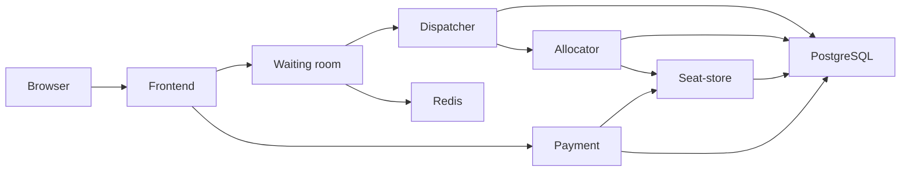

# Testing our ticket-booking application

This guide explains **what to test, why it matters, what to do, and what a correct
result looks like**. You do not need to understand every command before starting.
Follow the basic tests first. Open the expandable technical sections only when
you need them.

**Start with sections 1-4.** These explain the tools, create a safe test area and
walk you through normal bookings. Then test stopped workers and recovery. Leave
large traffic tests, fairness measurements and cloud-cost calculations until the
required tools are ready.

This is a test plan, not a record that every test has passed. Earlier checks have
shown the booking flow works in Docker and local Kubernetes, and stored data can
survive replacement of the database Pods. That does not yet prove the app can
handle heavy traffic, every crash, or public customer access.

## Contents

- [1. Words used in this guide](#1-words-used-in-this-guide)
- [2. Set up a safe testing area](#2-set-up-a-safe-testing-area)
- [3. Check that everything started](#3-check-that-everything-started)
- [4. Test the booking screens](#4-test-the-booking-screens)
- [5. Prove workers are doing their jobs](#5-prove-workers-are-doing-their-jobs)
- [6. Test restarts and interrupted work](#6-test-restarts-and-interrupted-work)
- [7. Check connections, configuration and access](#7-check-connections-configuration-and-access)
- [8. Test many users arriving together](#8-test-many-users-arriving-together)
- [9. Test whether allocation is fair](#9-test-whether-allocation-is-fair)
- [10. Work out the hosting cost](#10-work-out-the-hosting-cost)
- [11. Other checks before cloud deployment](#11-other-checks-before-cloud-deployment)
- [12. Save your results and decide what is ready](#12-save-your-results-and-decide-what-is-ready)
- [13. Reset only the testing area](#13-reset-only-the-testing-area)
- [Appendix A: database safety checks](#appendix-a-database-safety-checks)
- [Appendix B: traffic-generator example](#appendix-b-traffic-generator-example)

Each test has a starting label:

| Label | Meaning |
| --- | --- |
| **Ready now** | The current app has what you need to try it. This does not mean the test has already passed. |
| **Needs setup** | You need a measuring tool or controlled test setup first. |
| **Needs code change** | A required feature or fix is missing. Do not claim this requirement is complete. |

## 1. Words used in this guide

| Word | Simple explanation | Example in our app |
| --- | --- | --- |
| Container | A packaged program and the things it needs to run | The payment image can run the payment API or its worker |
| Kubernetes / cluster | The system that starts and manages our programs | Our local Kind cluster is called `csc3104` |
| Node | A machine used by Kubernetes | We currently have one local node, running inside Docker |
| Pod | A running unit managed by Kubernetes | `payment-worker-...` runs the payment background process |
| Deployment | Instructions that keep a chosen number of application Pods running | If its Pod dies, the payment-worker Deployment starts a replacement |
| Replica | Another running copy of a component | Two waiting-room Pods can handle requests together |
| Worker | A program that does background work | The payment worker completes saved payment requests |
| Service | A stable internal address for a component | Other Pods use `http://payment-api:5004` |
| Namespace | A named area inside Kubernetes | `csc3104-lab` keeps test bookings separate from the main app |
| PostgreSQL | The database for durable booking and processing records | Holds, payment attempts and allocation jobs |
| Redis | The store used by the waiting room | Registered users, queue numbers and request state |
| PVC / persistent storage | Storage kept when a Pod is replaced | The new PostgreSQL Pod uses the existing database files |
| ConfigMap | Settings that are not private | Service URLs, batch size and hold duration |
| Secret | Kubernetes storage for private settings | Database passwords and internal tokens; this is not automatically encryption |
| Readiness check | A check used to decide whether a Pod should receive traffic | Payment can access its database and expected tables |
| Liveness check | A check used to decide whether a program should be restarted | Its HTTP listener still responds |
| Worker backlog | Work saved but not yet finished | Pending payment or allocation jobs |
| Idempotency | Repeating the same action does not create a second effect | Retrying Pay with the same key returns the same payment |
| Lease | A temporary claim on a saved job | A replacement can claim work after an abandoned claim expires |
| Fencing | A check that rejects an old worker's outdated claim | An old worker cannot overwrite a replacement's result |
| p95 response time | 95% of measured requests finished within this time | p95 = 800 ms means 95 out of 100 requests finished in about 800 ms or less |
| FCFS | First Come, First Served | Earlier queue positions get their allocation turn first |
| Trace | A saved list of customers and their actions | Both algorithms receive exactly the same test customers |

Our customer flow is roughly:



The APIs receive requests. Their workers finish saved work in the background.
Seat-store is the only component allowed to change seat ownership.

## 2. Set up a safe testing area

**Ready now.** Do this before deliberately stopping services or creating many users.

### Why use a testing area?

Confirmed seats stay booked even after restarting. We therefore use a namespace
called `csc3104-lab` for experiments, instead of changing your main bookings.
This uses the same code and images; it is not a second codebase.

| Address | What it opens |
| --- | --- |
| `http://127.0.0.1:18080` | Main Docker Compose app |
| `http://127.0.0.1:18090` | Main Kubernetes app |
| `http://127.0.0.1:18100` | Testing area used in this guide |

**Use port 18100 for these manual experiments.** Do not change the namespace in
failure/reset commands to the main `csc3104` namespace.

A namespace protects the separation of records, but still shares your laptop's
CPU/RAM and the Kubernetes node. It does not make heavy traffic or whole-node
failures harmless to other workloads. Do not restart Docker Desktop or touch
SpeakReadAI as part of these tests.

### Terminal A: start the project

Open Docker Desktop and wait until its engine is running. Open PowerShell in the
repository, then run:

```powershell
cd C:\Users\Hp\Documents\GitHub\CSC3104_G2_CloudProject
python demo.py --kubernetes
```

If `python` is not found, replace `python` with `.\.venv\Scripts\python.exe`.
Keep using the same interpreter below.

### Terminal A: create the lab

Paste this whole block. The long first command calls our existing deployment
helper to start the same services with separate test storage.

```powershell
python -c "import sys; sys.path.insert(0,'infra/k8s'); import local; local.deploy('csc3104-lab',hold_ttl=300,batch_size=50)"
if ($LASTEXITCODE -ne 0) { throw 'Lab did not start. Check the error above.' }

$KubeConfigPath = Join-Path (Get-Location) '.local/k8s/kubeconfig'
$LabNamespace = 'csc3104-lab'
function k {
    & kubectl --kubeconfig $KubeConfigPath --context kind-csc3104 --namespace $LabNamespace @args
    if ($LASTEXITCODE -ne 0) { throw 'The Kubernetes command failed.' }
}
k get pods
```

The `function k` lines create a shortcut in **this PowerShell window only**.
From now on, `k get pods` means “show Pods in our lab.” It saves you from typing
the full cluster and namespace settings each time. If you open a new Terminal A,
paste the shortcut block again.

Running the deployment again preserves existing test data. It does not start a
fresh sale. If the lab was used before, see section 13 to reset only its data.

### Terminal B: connect your browser to the lab

Open a second PowerShell window in the same repository and run:

```powershell
kubectl --kubeconfig .local/k8s/kubeconfig --context kind-csc3104 -n csc3104-lab port-forward --address 127.0.0.1 service/frontend 18100:8080
```

Leave this window running. It connects your laptop's port 18100 to the frontend.
It may look idle; that is normal. Open **http://127.0.0.1:18100** in your browser.
Use Terminal A for other commands. Pressing Ctrl+C in Terminal B closes the
browser connection, not the application or database.

This connection is suitable for checking behavior. It is not suitable for proving
that several frontend copies share high traffic evenly; advanced load tests need
a suitable test gateway or direct Kubernetes Service connection.

## 3. Check that everything started

**Ready now.** Run in Terminal A:

```powershell
k get 'pods,pvc,services,jobs'
```

Keep the quotes around comma-separated resource types. Our PowerShell `k`
shortcut otherwise splits them into separate arguments, making Kubernetes look
for Pods named `pvc`, `services` and `jobs`. That error does not mean those
components are missing.

| What you see | What it means | Expected starting result |
| --- | --- | --- |
| A normal application's `READY` column | Kubernetes considers it ready | `1/1` |
| Its `STATUS` column | Whether the process is running | `Running` |
| `seat-init`, `allocation-init`, `payment-migrate` | One-time database setup tasks | `Completed`; `0/1` is normal after completion |
| PostgreSQL/Redis PVC rows | Whether their storage was assigned | Two rows showing `Bound` |
| Services | Internal component addresses | Frontend, five APIs, PostgreSQL and Redis |

After startup settles, expect **13 running application/storage Pods**, plus
**three completed setup Jobs**. During a rollout you may briefly see old Pods
marked `Terminating`; wait for the rollout to finish before counting.

**Pass:** the expected components are running and the lab page opens.
**If it fails:** read the error, then run:

```powershell
k get events --sort-by=.lastTimestamp
k logs deployment/payment-api --tail=50
```

Change `payment-api` only to the component you are investigating. Do not delete
database storage to make a startup error disappear.

## 4. Test the booking screens

### Test B1: complete a booking

**Ready now.** This checks the whole customer journey.

1. Open the lab page on port 18100 and choose **My booking**.
2. Enter a test name, then click **Continue**.
3. Choose section A and party size 2, then click **Register**.
4. Go to **Overview** and click **Start sale**. If it already started, new users
   should join the active queue without another start.
5. Return to **My booking** and wait for reserved seats.
6. Click **Complete mock payment**.
7. Check **Seat map** and **Batches** as well as the confirmation screen.

**Pass:** the booking becomes CONFIRMED, shows two adjacent seats and a booking
reference, and those seats are confirmed in the seat map. A short `pending`
payment state is normal while the worker finishes.

**Save:** request ID, hold/booking reference, payment outcome and a screenshot.
These are simulated payments: never enter real card details.

### Test B2: declined payment followed by retry

**Ready now.** Use **Switch user** to make a new test customer and obtain a new hold.

1. Note the countdown.
2. Click **Simulate decline** and wait for the declined result.
3. Click **Complete mock payment** before the original hold ends.

**Pass:** the decline does not confirm seats; retry can confirm them; the timer
does not jump back to five minutes. Retrying is not a new seat reservation.

### Test B3: cancel an unpaid reservation

**Ready now.** Obtain another fresh hold.

1. Note the assigned seat numbers.
2. Click **Cancel reservation** and confirm.
3. Wait for cancellation to finish, then inspect those seats in **Seat map**.

**Pass:** the whole party's seats become available again. Already confirmed seats
must never be released by this unpaid-cancellation flow. A short “cancellation
pending” period is normal.

### Test B4: do not pay before the hold ends

**Ready now.** Obtain a fresh hold and leave it unpaid.

1. Wait until five minutes have passed from allocation, not from opening the page.
2. Try to pay after the deadline.
3. Watch the seat map for the seats to become available.

**Pass:** late payment is rejected and the seat worker releases the whole party.
Allow the worker's scan/processing time; release is not guaranteed at the exact
millisecond the browser countdown reaches zero.

**Known issue:** the booking summary can still display RESERVED/ACTIVE after
expiry. Record this as a UI failure even if the backend correctly rejects payment.
Do not use that stale label as the only evidence of the actual seat state.

### Test B5: no suitable adjacent seats remain

**Ready now**, but use a fresh lab and plan the inventory first.

Fill a section until it cannot fit the next party, then register another party
for that section. Section C has 10 seats in the default map. Three parties of
four cannot all fit there, even if other sections still have space.

**Pass:** the request ends as UNAVAILABLE and receives no partial party. “Four
seats are free” is not sufficient if they are scattered rather than adjacent.

### Test B6: refresh, leave and return

**Partly ready; some required behavior needs code changes.**

| Try this | Correct result |
| --- | --- |
| Refresh while queued | Same request and queue position |
| Refresh while seats are held | Same hold, seats and original deadline |
| Refresh after payment succeeds | Same confirmed booking; no second payment |
| Open two tabs | No extra queue entry or booking |
| Return after expiry/cancellation | Correct ended state; no revived old hold |
| Use another browser/device | Must use verified identity to restore the right customer; localStorage alone cannot do this |

We must also decide what **rejoin** means. Recommended rule: reconnecting restores
the same request; an ended attempt does not automatically gain a new queue entry.
If new attempts are allowed, they need a new ID and a position at the end.

**Current problem:** documentation says “no rejoin,” but a rejoin API still exists.
Choose the rule, update the code and documentation, then test it. This guide does
not silently remove the endpoint. Mark the requirement unfinished until both agree.

### Quick automated check

For a quick overall check instead of clicking every screen:

```powershell
python demo.py --kubernetes --verify
```

This creates and removes its own temporary test area, checks bookings and storage,
then redeploys the main app. It uses 30-second test holds. Do not run it during
another experiment; it is not a traffic, fairness or complete crash test.

For the retained lab on port 18100, the existing checker can also be run directly:

```powershell
python tests/docker_booking_smoke.py --base-url http://127.0.0.1:18100 --allow-bookings --timeout 360
```

This requires a fresh, empty lab. It creates confirmed seats and waits for real
expiry when holds are 300 seconds. Repeated startup does not reset those seats.

## 5. Prove workers are doing their jobs

### Test W1: payment API is available, but its worker is stopped

**Ready now.** This demonstrates why “the API is healthy” does not mean payment
processing is working.

1. Obtain a fresh unpaid hold in the lab.
2. In Terminal A, stop the payment worker:

```powershell
k scale deployment payment-worker --replicas=0
k get pods -l app=payment-worker
```

3. Wait until no payment-worker Pod is listed, including Pods marked Terminating.
   Do not click Pay while an old worker is still finishing.
4. Click **Complete mock payment**. Inspect the API and saved work:

```powershell
Invoke-RestMethod http://127.0.0.1:18100/api/payment/health
k exec deployment/payment-api -- python service.py monitor
```

**Expected now:** the API can still say `ok`, but the payment stays pending. In
the monitoring output, `pending.count` is the number of unfinished payment
attempts. The heartbeat age is how long since a payment worker last reported.

5. Restore the worker promptly, while the original hold is still valid:

```powershell
k scale deployment payment-worker --replicas=1
k rollout status deployment/payment-worker --timeout=180s
```

**Pass:** the original payment finishes without needing a new payment or hold.
If the hold expired during the experiment, the correct result is expired, not
confirmed. Record which case you tested.

### Other workers: what should you watch?

| Worker | Its job | Evidence it is progressing |
| --- | --- | --- |
| `allocation-worker` | Requests seat holds for saved allocation jobs | Requests move to RESERVED or UNAVAILABLE |
| `dispatcher-worker` | Advances saved batches | Batch phases reach completion |
| `waiting-recovery` | Finishes interrupted sale opening and triggers dispatch | Queue numbering/sale opening resumes |
| `seat-worker` | Releases overdue holds and sends saved callbacks | Seats become available; callbacks are acknowledged |
| `payment-worker` | Resolves saved payment/cancellation work | Same saved payment/action IDs reach final outcomes |

For allocator testing, pause `allocation-worker`, queue a request, then restore it.
For seat-worker testing, pause it, let a hold pass its deadline, check late payment
is rejected, then restore it and check release.

**Important:** stopping dispatcher-worker alone may NOT stop dispatching:
waiting-recovery also calls the dispatcher API. That can be correct recovery
behavior. To isolate dispatcher-worker, also pause waiting-recovery and avoid
manual start-sale/dispatch triggers. Restore both afterwards. To test
waiting-recovery specifically, use an interrupted OPENING state; ordinary
dispatch may continue through the dispatcher worker without it.

### Reading monitoring output

| Field/state | Plain meaning |
| --- | --- |
| QUEUED / READY | Work is saved and waiting for a turn |
| IN_PROGRESS | A worker temporarily owns the job |
| RETRY | A failed operation is waiting to try again |
| BLOCKED | Automatic processing stopped; investigate and repair |
| DONE / terminal allocation state | That stage finished; still check the actual booking result |
| `pending.count` | Number of unresolved payment attempts |
| `worker_heartbeat_age_seconds` | Time since any payment worker last reported |

A shared heartbeat does not prove EVERY worker copy works. Also, the age since
a job was last updated is not the same as how long the customer has waited:
retries change the update time. Optional notifications remain pending when
PAYMENT_STATUS_URL is intentionally empty; report that separately.

## 6. Test restarts and interrupted work

### Test R1: normal worker restart

**Ready now.** Submit a lab payment, keep its IDs, then run:

```powershell
k rollout restart deployment/payment-worker
k rollout status deployment/payment-worker --timeout=180s
```

**Pass:** already accepted work is not lost. It either finishes before shutdown
or the replacement continues it using the original IDs. The app must not create
a second reservation to recover.

Our workers normally get 45 seconds to stop. Payment/allocator job claims normally
last 30 seconds. These are settings, not a guaranteed total recovery time: faults,
timeouts and retry delays also matter. Measure actual recovery.

### Test R2: replace database/storage Pods

**Ready now in the lab.** First create a confirmed booking and note its reference,
seats and queue records. Then:

```powershell
k get pvc
k delete pod postgres-0 redis-0
k rollout status statefulset/postgres --timeout=180s
k rollout status statefulset/redis --timeout=180s
k get 'pods,pvc'
```

**Pass:** the same storage claims remain, existing records return, and the app can
make a NEW booking without you restarting every API. This last step checks that
the app reconnects, rather than only proving the database files exist.

This does not prove survival of a failed machine, deleted cluster or destroyed
disk. Deleting the Kind cluster deletes its local storage.

### Test R3: a dependency disappears temporarily

**Ready now for a basic outage.** Example using seat-store:

1. Stop payment-worker before accepting a new payment.
2. While seat-store is still available, submit that payment and confirm it is saved.
3. Stop seat-store, then restore the payment worker:

```powershell
k scale deployment seat-api --replicas=0
k scale deployment payment-worker --replicas=1
```

4. Observe that payment cannot finish. It must not pretend the venue is sold out
   or that payment succeeded.
5. Restore seat-store before the original hold ends:

```powershell
k scale deployment seat-api --replicas=1
k rollout status deployment/seat-api --timeout=180s
```

**Pass:** the same payment resolves correctly. Repeat separately with an outage
long enough for expiry; that run must not confirm an expired hold.

Restore every component you paused. Do not judge recovery only by the Pod turning
green: inspect the saved request and its actual final state.

### Advanced crash tests

**Needs setup.** Some failures happen too quickly to place reliably by clicking.
They need a controlled network proxy or a test-only pause at an exact checkpoint.

| Stop or lose a response at this point | What must happen |
| --- | --- |
| Seat hold saved, allocator has not recorded the reply | Retry finds the SAME hold and expiry |
| Seat confirmation saved, payment worker has not recorded it | Recovery finds the confirmation; no second booking |
| Batch accepted, dispatcher misses the reply | Same batch continues; no duplicate queue admission |
| Release saved, callback receiver is unavailable | Saved callback retries; released seats stay released |
| Old worker replies after a replacement owns the job | Its outdated claim is rejected; it cannot overwrite the replacement |
| Duplicate/late event arrives | No repeated effect or downgrade of an ended booking |
| One invalid job is followed by valid jobs | Invalid work is visible; unrelated valid work can continue |

Randomly killing a Pod does not prove you hit “after save, before reply.” Existing
mocked response-loss tests help, but the real Kubernetes version must also show
the intended checkpoint. The goal is no duplicate EFFECT, not a promise that the
network call can only be sent once.

<details>
<summary>Advanced command: force-stop a specific lab payment worker</summary>

Use only after recording the operation and checking the target. This is a hard
crash, not a graceful restart. A force-deleted Pod may not mean the old process
has already stopped, particularly during a network partition.

```powershell
$WorkerPod = (k get pods -l app=payment-worker -o jsonpath='{.items[0].metadata.name}')
if ($WorkerPod -notlike 'payment-worker-*') { throw 'Unexpected target Pod' }
k delete pod $WorkerPod --grace-period=0 --force
k rollout status deployment/payment-worker --timeout=180s
```

</details>

Decide your recovery target BEFORE testing. For example: after a 20-second outage,
valid work should settle within 90 seconds of restoring the dependency, with no
lost accepted requests. This is a proposed test target, not a result already proven.

If payment work becomes BLOCKED, inspect it and fix its cause before retrying:

```powershell
k exec deployment/payment-api -- python service.py work-status
k exec deployment/payment-api -- python service.py retry-work --work-id '<blocked-work-id>'
```

Replace `<blocked-work-id>` with the exact ID from the first command. Do not delete
jobs or edit lease fields to make them disappear. Allocator BLOCKED work does not
yet have an equivalent supported repair command; that operating procedure needs work.

## 7. Check connections, configuration and access

### Test D1: internal connections stay stable

**Ready now.** A Service is a stable address even when its Pod changes.

```powershell
k get services
k get endpointslices
```

The second command shows which Pod addresses the Services currently point to.
Replace an API Pod, wait for its replacement, then repeat a booking. Other services
should keep using the same Service name rather than an old Pod IP address.

<details>
<summary>Copy-paste checks: resolve service names and check the five APIs</summary>

Run in Terminal A. Expected: every name resolves and every HTTP status is 200.
These checks do not prove that background work is progressing.

```powershell
k exec deployment/frontend -- python -c "import socket; names=['waiting-room','dispatcher-api','allocation-api','seat-api','payment-api','postgres','redis']; [print(n,socket.gethostbyname(n)) for n in names]"
k exec deployment/frontend -- python -c "import requests; paths={'waiting-room:5001':'/ready','dispatcher-api:5005':'/ready','allocation-api:5002':'/ready','seat-api:5003':'/health','payment-api:5004':'/ready'}; [(print(h,requests.get('http://'+h+p,timeout=5).status_code)) for h,p in paths.items()]"
```

The full booking must exercise frontend -> APIs, waiting-room -> Redis,
dispatcher -> waiting-room/allocator, allocator -> seat-store,
seat-worker -> payment callback, and payment -> seat-store. PostgreSQL stores
each service's own records in separate databases.

</details>

### Test D2: settings and private values

**Ready now for inspection; security improvements need code/configuration changes.**

```powershell
k get 'configmaps,secrets'
k get deployment payment-api -o jsonpath='{.spec.template.spec.containers[0].env[*].name}'
```

You should find service URLs and ordinary settings in a ConfigMap, and password/
token references in a Secret. Do not print Secret contents into reports or copy
passwords into Git. Separate database roles should not be administrator accounts.

Before public deployment we also need different passwords for different services,
limited runtime database permissions, a separate checkout signing key, and a safe
way to give that signed checkout permission to the correct logged-in customer.
The current local Kubernetes setup does not complete those steps.

For an advanced lab test, deliberately use a wrong credential, then restore it.
Expect a clear error, no data deletion and recovery with the correct credential.
Changing a Secret does not change an existing PostgreSQL password or automatically
reload a running program: test the actual update/restart procedure.

### Test D3: startup, readiness and liveness checks

**Ready now.** Inspect the settings:

```powershell
k get 'deployment,statefulset' -o yaml
```

| Check | What it should do |
| --- | --- |
| Startup | Give the program time to start before other checks begin |
| Readiness | Stop sending new Service traffic to a Pod that is not ready |
| Liveness | Restart a program judged unhealthy; avoid repeatedly restarting every API just because a dependency is down |

Waiting-room readiness checks Redis. Allocator, dispatcher and payment readiness
check their own database state. Seat-store's `/health` checks its database;
therefore its liveness check uses its TCP listener instead. Frontend checks `/`.
Storage checks use pg_isready/PING. Workers are process-supervised and do not have
made-up HTTP health endpoints.

**Pass:** slow startup is tolerated, genuinely unready Pods leave ready Service
addresses, and a dependency outage does not cause a restart loop everywhere.
Payment may still be ready while seat-store is unavailable: it can access its own
records, but that is not proof it can finish a new booking.

### Test D4: resource limits

**Ready now for inspection; measuring usage needs a metrics tool.** Every API,
worker, storage container and setup Job should have CPU/RAM requests and limits.
A request helps Kubernetes decide where it can run; a limit caps the container.

Under controlled stress record memory kills, CPU throttling, waiting Pods and
restarts. Also test database connection and lock exhaustion: spare CPU does not
mean the database has spare connections. An HTTP timeout alone does not cancel
all database work.

### Test D5: who is allowed to do what?

**Needs code changes before public access.** Test the real frontend/gateway,
not only payment's internal API.

| Try this | Required result before public release |
| --- | --- |
| Anonymous visitor starts the sale or runs admin actions | Denied; no state change |
| Customer A reads, pays or cancels customer B's hold | Denied; B's data is not exposed |
| Customer calls internal/operator/callback paths through the proxy | Denied |
| Missing, altered, expired or wrong-permission checkout token | Denied; no action saved |
| Internal service token used as customer login, or the reverse | Denied |
| Valid customer checkout | Only its assigned request/hold can be affected |

The current frontend adds an internal credential but does not establish customer
ownership. Its admin controls are also not properly protected. Treat this as an
unfinished security requirement; keep the app private/local for now.

Also check HTTPS, safe browser rendering, body/connection limits and secret-free
logs. The proxy currently drops some upstream headers, including `Retry-After`
and payment cache/security headers. “Retry later” guidance must reach the actual
client, not disappear between payment and the browser.

## 8. Test many users arriving together

**Needs measuring tools and a fuller request record.** The purpose is to find how
much work the system handles and what happens when that amount is exceeded.

### What to measure

| Measure | What it means |
| --- | --- |
| Offered RPS | Requests the test tries to send each second |
| Completed RPS | Requests that actually finish each second |
| p50 / p95 / p99 | Times that 50%, 95% and 99% of measured requests finish within |
| Error count | Separate timeouts, server errors and deliberate busy responses |
| Queue size | Customers still waiting, not everyone who ever registered |
| Oldest waiting customer | How long the longest-waiting eligible customer has waited |
| Worker backlog | Saved jobs still waiting/processing/retrying/blocked |
| Ready replicas | Copies actually ready, not just copies Kubernetes requested |
| Database connections | Connections used by ALL API processes and workers |
| Lost or duplicate work | Accepted requests missing after recovery, or repeated booking effects |

### Follow this order

1. Use fresh lab data for each independent run.
2. Start small: 5, then 10, 25, 50 and 100 offered requests/second if the machine
   remains healthy. These are starting test inputs, not promised capacity.
3. Test registration BEFORE the sale separately from full booking journeys.
4. Test polling existing requests separately, including the frontend's load.
5. Run a stable workload, a short burst, then stop new arrivals and watch the
   queue drain. Add a longer 30-60 minute run at a sustainable rate.
6. Record every test customer's identity, saved IDs, response, timing and eventual
   result. Include requests with errors or timeouts.
7. Run the database safety checks in Appendix A after the work settles.

**Pass:** all acknowledged work can be found afterwards; repeated requests do not
duplicate bookings; overload gives clear, bounded failures/retry guidance; the
system recovers after traffic falls. Fast responses do not excuse double booking.

Pick response-time/error targets BEFORE running. Example student targets might
be p95 <= 1 second, p99 <= 2 seconds and unexpected server errors < 1% at a chosen
normal rate, with zero booking-safety violations at every rate. These examples
are not performance results or universal production standards.

### Mistakes that would make the results misleading

- The dev map has only 70 seats. Thousands of arrivals quickly test “sold out,”
  not sustained successful booking. A larger `eval` map has 400 seats, but requires
  a fresh database and configuring it BEFORE the setup Jobs; our helper initializes
  dev immediately, so this needs an experiment setup change.
- The existing waiting-room load script ties section A to size 1, B to size 2,
  C to size 3 and D to size 4. Do not use it to prove party-size fairness.
- A fixed number of test users waiting for replies sends less traffic when the
  app slows. A constant-arrival tool keeps attempting new arrivals. Appendix B
  provides a starter and explains its limits.
- If the generator cannot emit the planned rate, record its dropped work. That
  does not prove the server handled the target rate.
- An HTTP timeout means “we do not know the result yet.” Retry with the SAME
  logical identity/key and look up the result before declaring it lost.
- A successful payment submission can still be pending, not confirmed.
- Payment's average/maximum latency metrics cannot give p95/p99. Use individual
  request timings or suitable histogram measurements.
- Registration time includes pre-sale waiting. True allocation waiting time needs
  a recorded time when that request became eligible. Several stage timestamps
  and the full measurement/record-collection tool still need implementation.

### Useful background measurements

```powershell
k exec deployment/payment-api -- python service.py monitor
k exec postgres-0 -- psql -U postgres -d allocation -c "SELECT state,count(*) FROM allocation_jobs GROUP BY state;"
k exec postgres-0 -- psql -U postgres -d payment -c "SELECT kind,state,count(*) FROM wy_work GROUP BY kind,state ORDER BY kind,state;"
k exec postgres-0 -- psql -U postgres -c "SELECT datname,usename,state,count(*) FROM pg_stat_activity WHERE backend_type='client backend' GROUP BY datname,usename,state ORDER BY datname,usename,state;"
```

Start by sampling about every five seconds and save timestamps. Monitoring itself
uses resources; constantly refreshing a large admin queue also adds load.

### Test whether extra copies help

**Ready now for manual copies; automatic scaling needs setup.** Change one
component at a time, repeat the SAME traffic, and compare useful throughput/errors:

```powershell
k scale deployment waiting-room --replicas=2
k rollout status deployment/waiting-room --timeout=180s
```

Try appropriate counts such as 1,2,4. Restore the starting count afterwards.
Do not simply add PostgreSQL/Redis replicas: that does not set up replicated data.

More workers do not always mean more throughput. Dispatcher allows one active
batch. Allocator allows one party in flight per section, so A-D allows at most
four simultaneous section allocations. The frontend can also be the bottleneck.

**Automatic scaling (HPA)** means Kubernetes changes the number of copies based
on measurements. Its metrics provider is not installed by our current launcher.
Once it is set up in an agreed test cluster:

```powershell
k get --raw /apis/metrics.k8s.io/v1beta1
k top pods
k autoscale deployment waiting-room --cpu-percent=70 --min=1 --max=4
k get hpa -w
```

`-w` means keep watching; Ctrl+C stops watching. Test when more copies are requested,
when they become ready, whether performance actually improves and whether they
later scale down. CPU alone may miss work waiting on a database. Scaling Pods on
one laptop node does not demonstrate automatic creation of extra cloud machines.
Remove the lab HPA or restore its settings between comparisons.

## 9. Test whether allocation is fair

**Needs an FCFS comparison and a repeatable measurement tool first.** There is
currently no implemented FCFS benchmark command; do not invent a switch or compare
two Demand-Cycle runs as though they were different policies.

### What the comparison means

Our Demand-Cycle policy may change who gets their turn first. FCFS is the control:
earlier queue positions get their allocation turn first within the same section
and batch. Keep the same workers, cross-section concurrency, seat selection,
hold duration, batches and retry rules. A fully serial global FCFS is a different
comparison and should be reported separately.

A small order-only example for one section:

| Queue position | Party size |
| --- | --- |
| 1 | 4 |
| 2 | 1 |
| 3 | 1 |
| 4 | 2 |
| 5 | 2 |

FCFS visits **1,2,3,4,5**. Demand-Cycle ranks sizes 1,2,4 here and visits
**2,4,1,3,5**. This can check the ordering code; it does NOT prove either policy
is fairer or gets more customers seated.

### How to run a fair comparison

1. Save a customer list: arrival time, identity, section, party size, queue number,
   batch, payment action, and payment/cancel delay.
2. Start both policies from identical seats and existing occupancy.
3. Give both policies the SAME customers, queue numbers, batches and behavior.
4. Use the same finishing/drain time and include anyone still waiting.
5. Repeat with at least 10 paired random seeds per scenario if resources allow.
   Alternate which algorithm runs first and report variation, not only the best run.

**Important:** pre-sale numbering uses SystemRandom. Giving the client the same
seed does not reproduce that lottery. Capture and replay the same assigned queue,
or implement a benchmark-only way to provide it.

### Customer scenarios

| Scenario | Simple setup | What it checks |
| --- | --- | --- |
| Balanced | Similar numbers of parties of sizes 1-4 in EACH section | Basic group comparison |
| Mostly small parties | For example, 70% size 1 | Majority/minority behavior |
| Mostly large parties | A separate 70% size 4 run | Whether large parties are disadvantaged |
| Popular section | For example, 80% choose A; size chosen independently | Section pressure |
| Nearly sold out | Same fixed 80%/90% initial occupancy for both | Scarce capacity |
| Scattered free seats | Same gaps within rows | Whether adjacent seats can be found |
| Cancellations/expiry | Same saved payment/cancel/abandon behavior | Effects of released seats |

Create starting seats through seat-store-owned actions or a proper test fixture
loader, not arbitrary changes to several service databases. Extreme example:
confirm alternating positions in a 10-seat row. Five free seats may remain, but
none form an adjacent pair. Both policies should reject parties of two there;
that is not automatically unfairness. Also test less extreme patterns where
different sizes can fit.

### Results to record for each section AND party size

| Measure | Plain meaning |
| --- | --- |
| Success rate | Parties reserved / valid parties offered; keep failures in the denominator |
| Waiting time | How long each customer waits; show median and tail times, with group sample size |
| Failed/unfinished requests | Separate unavailable, expired, cancelled, infrastructure failure, blocked and still waiting |
| Overtaking | How many later queue positions get their allocation decision first in the same section/batch |
| Seat use | Confirmed seats / total seats; also show temporarily held seats over time |
| Fragmentation | Sizes of the remaining adjacent free blocks within each row |

Compare reservation outcomes and final confirmations separately so differences
in payment behavior do not get mislabeled as allocation fairness. Party-weighted
and seat-weighted success are different measures; report both when relevant.

Do not count parallel work in different sections as automatically overtaking.
Do not count a later party succeeding AFTER an earlier party already received
UNAVAILABLE as a change in decision order. Include failed decisions too.

For fragmentation, list free-block lengths per row, each row's largest block,
and seats trapped in blocks too short for each party size. If using a single
score, define it. One option is `1 - sum(largest block in each row)/all free seats`;
use N/A when no seats are free. Using only the largest block in the whole venue
would incorrectly make intact separate rows appear fragmented.

Never calculate waiting times only for successful customers and present them as
everyone's experience. Show still-pending customers separately when the run ends.
Do not overinterpret p99 from a tiny group. If using Jain's index or confidence
intervals, explain the inputs and keep the per-group results visible.

**Pass:** the comparison can be reproduced, safety rules hold, and claims match
the measured trade-offs. “Demand-Cycle wins every metric” is not a required result.

## 10. Work out the hosting cost

**Ready now for local resource recording; cloud costs need a chosen deployment.**

Our current local Kind setup creates no cloud-provider bill. That does not mean
a future cloud deployment is free. Record local CPU/RAM, disk and runtime now.

When choosing a provider, record the region, machine/service sizes, prices and
pricing date, currency, experiment duration and any credit/free-tier conditions.

| Cost item | What to record |
| --- | --- |
| Kubernetes control plane | Hours running and any cluster-management charge |
| Worker machines | Machine type, count and actual billed time, including idle time |
| PostgreSQL/Redis | Managed service charges OR their share of machine cost, not both for the same compute |
| Storage/backups | Allocated disk, snapshots, retained backups and restore traffic |
| Networking | Data leaving the service, cross-zone traffic, public IP, gateway and load balancer charges |
| Logs/monitoring | Data collected and stored; paid monitoring if used |
| Images/builds | Registry storage, downloads and paid build services if used |

Compare fixed capacity and automatic scaling with the SAME customer actions and
time window, including the time needed to finish queued work. Calculate:

- Total cost and idle cost.
- Cost before credits, credit used, and cash paid after credits.
- Cost per offered/resolved request and per confirmed booking.
- Service quality beside cost: rejecting everyone cheaply is not a useful win.

If no booking confirms, cost per confirmed booking is N/A, not zero. More Pods
that fit on already-paid machines may add no machine charge. Stopping Pods does
not necessarily stop billing for machines, disks, control planes or networking.
Use actual provider prices/bills; label projected costs as estimates.

## 11. Other checks before cloud deployment

These are not all needed before a private coursework demo, but they matter before
claiming a reliable public service.

| Test | In plain language, what must be shown? |
| --- | --- |
| Backup and restore | Restore into a separate test environment and prove the bookings, queue and history still work. A backup file alone is not proof. |
| Restore both stores consistently | PostgreSQL and Redis restored to different times must not leave missing batches/holds. Define a coordinated procedure. |
| Recovery time/data loss | Set how long recovery may take (RTO) and how much acknowledged data may be lost (RPO). For the tested process failures, target no lost accepted work. |
| Failed machine/disk | Use a separate disposable cluster. A namespace does not isolate a node failure, and one-node Kind does not prove high availability. |
| Full disk/storage errors | Fail clearly without false success or corrupted records. Use bounded test storage, not the shared laptop's actual disk. |
| Slow dependencies/retry storms | Many retries must not overload a recovering service again. Use bounded waits and delayed, varied retries. |
| Database connections/locks | Full pools and long queries should not create an endless pile-up. Measure waiting and recovery. |
| New software version | Upgrade a populated database including pending work; test migrations and define whether rollback is safe. |
| Mixed old/new workers | Old and new versions must understand saved jobs, or deployment must prevent incompatible overlap. |
| Poison jobs and repair | A bad event must be visible and repairable without stopping unrelated work or deleting history. |
| Browser/server clocks | A wrong browser clock cannot extend a hold. Use test clock controls, not changes to Windows time. |
| Identity and abuse | A user cannot create extra priority, steal another booking or run admin actions. Random queue order alone is not identity fairness. |
| Web security | Check safe rendering, CSRF if cookie login is added, CORS, HTTPS, caching, upload/body limits and header spoofing. |
| Secrets/permissions | Test key expiry/rotation, database permissions and secret-free logs. Keep signing and internal keys separate. |
| Repeatable release | Record actual image digests, dependencies and configuration; scan images; test a failed image pull and a safe rollback. |
| Long-running use | Watch for growing memory, connections, Redis data, dispatcher history and old audit/outbox data. Define retention/cleanup. |
| Alerts | Trigger a real stopped/blocked-worker situation. Another teammate should be able to notice, investigate and recover it. |
| More than one sale | Current inventory has no sale_id. Clearly declare one-sale scope, or implement/test separation before promising multiple events. |

Network-failure tools need validation too. A NetworkPolicy file only blocks
traffic if the installed networking system enforces it. Show one denied test and
one allowed control before trusting it. Do not replace the shared cluster's
networking just to run a lab test; use a controlled proxy or separate test cluster.

The system is a mock-payment project. Do not claim real charges, refunds, card
security compliance or financial settlement that it does not implement.

## 12. Save your results and decide what is ready

Use a simple table for every test:

| Test | What you expected | What actually happened | Result | Evidence / issue |
| --- | --- | --- | --- | --- |
| Example: stop payment worker | Payment stays pending, then resumes on the same ID | Fill after testing | NOT_RUN | IDs, timestamps, screenshot, database check |

Use these results honestly:

- **PASS:** you ran it and got the expected result.
- **FAIL:** you ran it and found wrong behavior.
- **BLOCKED:** you cannot run it because something required is missing.
- **NOT_RUN:** you have not tried it yet.

For serious measurements also save: commit and uncommitted-change information,
actual image IDs, node resources, replicas, limits, batch size, hold duration,
initial seats, saved customer trace/seed, payment timing, failure timing, start/end
timestamps and result files. Put artifacts under ignored `.local/test-results`.
Never save live passwords, Secret YAML, kubeconfig or bearer/signing credentials
into reports or Git.

For latency/capacity tests keep raw request timings and status totals. For fairness
keep per-group results and repeat-run variation. For recovery keep the operation
IDs and final database state. A screenshot supports those records; it cannot
prove by itself that no accepted request was lost.

### When should we stop and fix something?

Do not approve a release if a test finds:

- A seat belongs to two live bookings, a party gets only some of its seats, or a
  confirmed booking is released incorrectly.
- An acknowledged request disappears or the final stores disagree after the
  allowed recovery time.
- A user can affect someone else's checkout or perform an unauthorized admin action.
- The rejoin rule still contradicts the code/documentation.
- We cannot detect or safely repair blocked work, or cannot restore the data.

Before a public release, the agreed response-time/error goals, access controls,
backup/restore goals, operating instructions and budget must also pass. Fairness
claims need the actual FCFS comparison. State single-node/non-HA limits honestly.
A private coursework demonstration and a production service are different targets.

### Known work still needed

The current app still needs a consistent rejoin rule; trusted customer/admin
authorization; checkout-key delivery; correct forwarding of retry/security
headers; expiry-state UI refresh; clearer queue/stage timing and per-request
measurements; full-stack metrics/HPA setup; an FCFS evaluation tool; stronger
database credential/permission separation; registration overload protection;
and an agreed allocator repair procedure. Tests should expose these gaps, not
hide them behind a green Pod status.

## 13. Reset only the testing area

**Check your browser address first.** The reset commands target different areas:

| Browser address | Reset command | Data erased |
| --- | --- | --- |
| `http://127.0.0.1:18090` | `python demo.py --kubernetes --reset-demo` | Main local Kubernetes demo: all bookings, payment history and queue entries |
| `http://127.0.0.1:18100` | `python demo.py --kubernetes --reset-test-env` | Only the separate lab: all bookings, payment history and queue entries |

Resetting the lab will **not** clear the page at port 18090. To repeat the main
demo, run `--reset-demo`, wait for **Fresh main demo ready**, reload port 18090,
then click **Switch user** and register again. No port-forward is needed for
18090. Both reset commands restore the initial seats and pre-sale state; neither
resets Docker Compose at port 18080. Normal startup still preserves data.

### Reset the lab at port 18100

Use this when you need a new independent experiment. It deletes lab bookings,
database files and queue data. It does NOT reset the main application.

1. Press Ctrl+C in Terminal B to close the lab browser connection.
2. In Terminal A run this command:

```powershell
python demo.py --kubernetes --reset-test-env
```

3. Wait until it prints **Fresh lab ready**. It recreates all lab APIs, workers,
   databases, queue and initial seats. If it fails, fix the reported error before
   continuing; do not assume the reset completed.
4. Reopen the Terminal B connection using the command from section 2.
5. Open http://127.0.0.1:18100. Click **Switch user** if a previous user is shown,
   then register again. This clears the old browser request too.

You should see **pre_sale**, an empty queue and available seats. You can now
simulate users, start the sale, and repeat the payment/decline/cancel tests.
Add `--batch-size 10` to the reset command for a smaller demonstration batch.
The command uses the images already loaded in the local cluster. After code
changes, run `python demo.py --kubernetes` first to rebuild/load the images.

Never replace `csc3104-lab` with the main namespace or delete the Kind cluster
as a shortcut for clearing test users.

## Appendix A: database safety checks

**Ready now after some bookings exist.** These checks look for impossible or
unsafe ownership. They do not alter data. Run after each experiment has settled.
If the database is empty, zero problems is not meaningful concurrency evidence.

<details>
<summary>Open to copy the database-check commands</summary>

Run in Terminal A after creating its `k` shortcut and lab variables.

```powershell
$SeatInvariantSql = @'
SELECT 'available_seat_has_owner' AS test, count(*) AS violations
FROM seats WHERE state='AVAILABLE' AND current_hold_id IS NOT NULL
UNION ALL
SELECT 'state_does_not_match_hold', count(*)
FROM seats s JOIN holds h ON h.hold_id=s.current_hold_id
WHERE (s.state='HELD' AND h.status<>'ACTIVE')
   OR (s.state='CONFIRMED' AND h.status<>'CONFIRMED')
   OR h.status IN ('EXPIRED','CANCELLED')
UNION ALL
SELECT 'partial_live_party', count(*) FROM (
 SELECT h.hold_id FROM holds h LEFT JOIN seats s ON s.current_hold_id=h.hold_id
 WHERE h.status IN ('ACTIVE','CONFIRMED')
 GROUP BY h.hold_id,h.party_size HAVING count(s.seat_id)<>h.party_size
) bad
UNION ALL
SELECT 'non_adjacent_live_party', count(*) FROM (
 SELECT h.hold_id FROM holds h JOIN seats s ON s.current_hold_id=h.hold_id
 WHERE h.status IN ('ACTIVE','CONFIRMED') GROUP BY h.hold_id
 HAVING count(DISTINCT s.section)<>1 OR count(DISTINCT s.row)<>1
     OR max(s.position_in_row)-min(s.position_in_row)+1<>count(*)
) bad
UNION ALL
SELECT 'duplicate_live_request', count(*) FROM (
 SELECT request_id FROM holds WHERE status IN ('ACTIVE','CONFIRMED')
 GROUP BY request_id HAVING count(*)>1
) bad
UNION ALL
SELECT 'seat_in_multiple_live_histories', count(*) FROM (
 SELECT hs.seat_id FROM hold_seats hs JOIN holds h ON h.hold_id=hs.hold_id
 WHERE h.status IN ('ACTIVE','CONFIRMED') GROUP BY hs.seat_id
 HAVING count(DISTINCT h.hold_id)>1
) bad;
'@
$SeatInvariantSql | kubectl --kubeconfig $KubeConfigPath --context kind-csc3104 --namespace $LabNamespace exec -i postgres-0 -- psql -U postgres -d seats -v ON_ERROR_STOP=1
if ($LASTEXITCODE -ne 0) { throw 'Invariant query failed' }

k exec postgres-0 -- psql -U postgres -d payment -c "SELECT hold_id,count(*) FROM wy_payments WHERE attempt_status='pending' GROUP BY hold_id HAVING count(*)>1;"
k exec postgres-0 -- psql -U postgres -d payment -c "SELECT hold_id,count(*) FROM wy_payments WHERE attempt_status='succeeded' GROUP BY hold_id HAVING count(*)>1;"
```

</details>

How to read the output:

| Check name | What a non-zero result means |
| --- | --- |
| `available_seat_has_owner` | A seat says available but still has an owner |
| `state_does_not_match_hold` | The seat and its booking disagree about their state |
| `partial_live_party` | An active/confirmed party owns the wrong number of seats |
| `non_adjacent_live_party` | A live party crosses rows/sections or has gaps |
| `duplicate_live_request` | One request has more than one active/confirmed hold |
| `seat_in_multiple_live_histories` | The same seat appears in more than one live booking history |

Every `violations` value should be **0**. The final two payment queries should
return **no rows**: no hold should have two pending attempts or two successful
attempts. A seat can correctly appear in different CLOSED historical holds after
release/reuse; that alone is not double booking.

Also compare total inventory before/after, keep the original expiry across retries,
and check UNAVAILABLE requests have no live hold. To compare payment, allocator
and waiting-room records, match their IDs to authoritative holds. They use separate
databases/stores; do not pretend ordinary SQL joins them all automatically.

Some updates are allowed to arrive shortly after the seat change. Set a time limit
for that delay and fail unresolved mismatches after it. For deadline races, the
important decision is the database time check after seat locks are acquired, not
only the browser click or a later commit timestamp.

## Appendix B: traffic-generator example

**Needs setup: install k6 first.** This is only a pre-sale registration starter.
It is not the missing full-journey or fairness tool, and has not been run as a load
experiment during this documentation review.

<details>
<summary>Open to copy the optional k6 script</summary>

Create `.local/load`, then save this as `.local/load/register.js`.

```javascript
import http from 'k6/http';
import exec from 'k6/execution';
import { Counter } from 'k6/metrics';

const base = (__ENV.BASE_URL || 'http://127.0.0.1:18100').replace(/\/$/, '');
const runId = __ENV.RUN_ID;
if (!runId) throw new Error('Set a unique RUN_ID');
const codes = new Counter('registration_status_total');
export const options = {
  scenarios: {
    arrivals: {
      executor: 'constant-arrival-rate', rate: Number(__ENV.RATE || 5),
      timeUnit: '1s', duration: __ENV.DURATION || '60s',
      preAllocatedVUs: 20, maxVUs: 100, gracefulStop: '35s',
    },
  },
  summaryTrendStats: ['avg', 'min', 'med', 'max', 'p(95)', 'p(99)'],
};
export function setup() {
  const response = http.get(`${base}/api/waiting-room/status`);
  const state = response.json();
  if (response.status !== 200 || state.sale_state !== 'pre_sale' || state.waiting_count !== 0)
    throw new Error('Use a fresh, empty, pre-sale lab');
}
export default function () {
  const i = exec.scenario.iterationInTest;
  const user = `${runId}-${i}`;
  const payload = {
    user_id: user, section: 'ABCD'[Math.floor(i / 4) % 4], party_size: i % 4 + 1,
  };
  const sentAt = new Date().toISOString();
  const response = http.post(`${base}/api/waiting-room/submit`, JSON.stringify(payload), {
    headers: { 'Content-Type': 'application/json' }, timeout: '30s',
    tags: { name: 'register' },
  });
  codes.add(1, { status: String(response.status) });
  let requestId = null;
  try { requestId = response.json().request_id || null; } catch (_) {}
  const accepted = (response.status === 200 || response.status === 201) && requestId !== null;
  const rejected = [400, 401, 403, 404, 409, 413, 422, 429].includes(response.status);
  console.log(JSON.stringify({
    run_id: runId, user_id: user, request_id: requestId,
    section: payload.section, party_size: payload.party_size,
    sent_at: sentAt, response_at: new Date().toISOString(),
    status: response.status, latency_ms: response.timings.duration,
    outcome: accepted ? 'accepted' : rejected ? 'rejected' : 'unknown',
  }));
}
export function handleSummary(data) {
  const directory = __ENV.RESULT_DIR || '.local/test-results/registration';
  return { [`${directory}/summary.json`]: JSON.stringify(data, null, 2) };
}
```

</details>

Use a fresh lab and keep Terminal B running. In another terminal run:

```powershell
$RunId = 'registration-' + (Get-Date -Format 'yyyyMMdd-HHmmss')
$ResultDir = '.local/test-results/' + $RunId
New-Item -ItemType Directory -Force -Path $ResultDir | Out-Null
k6 version
k6 run --out "json=$ResultDir/samples.json" --console-output "$ResultDir/requests.log" -e "BASE_URL=http://127.0.0.1:18100" -e "RUN_ID=$RunId" -e "RESULT_DIR=$ResultDir" -e RATE=5 -e DURATION=60s .local/load/register.js
```

This tries five registrations per second for one minute. Do not start the sale
during this registration-only run.

| Output file | What to use it for |
| --- | --- |
| `summary.json` | Overall measurements |
| `samples.json` | Individual metric samples and timing analysis |
| `requests.log` | Synthetic user IDs, returned request IDs and known/unknown outcomes |

Check dropped_iterations: those are arrivals the generator could not start.
Filter raw timings to the `register` operation; the setup status request also
appears in overall HTTP metrics. Logging and saving samples add overhead; measure
the generator too, especially at higher rates.

Find every accepted request in Redis afterwards. Retry an unknown result using
the SAME synthetic user identity, keeping the original evidence. A new request
for an already acknowledged identity after recovery needs investigation. This
simple script does not do that whole verification automatically.

Recreate the lab between independent runs. Do not use its simple repeating
customer pattern as a randomized fairness trace, or its port-forward path as
proof that a cloud gateway balances traffic across replicas.

## References

- [Kubernetes probes](https://kubernetes.io/docs/tasks/configure-pod-container/configure-liveness-readiness-startup-probes/)
- [Kubernetes HPA and metrics prerequisites](https://kubernetes.io/docs/concepts/workloads/autoscaling/horizontal-pod-autoscale/)
- [Kubernetes NetworkPolicy enforcement](https://kubernetes.io/docs/concepts/services-networking/network-policies/)
- [Kubernetes Secrets and security considerations](https://kubernetes.io/docs/concepts/configuration/secret/)
- [k6 constant-arrival-rate executor](https://grafana.com/docs/k6/latest/using-k6/scenarios/executors/constant-arrival-rate/)
- [k6 generator/VU capacity and dropped iterations](https://grafana.com/docs/k6/latest/using-k6/scenarios/concepts/arrival-rate-vu-allocation/)
