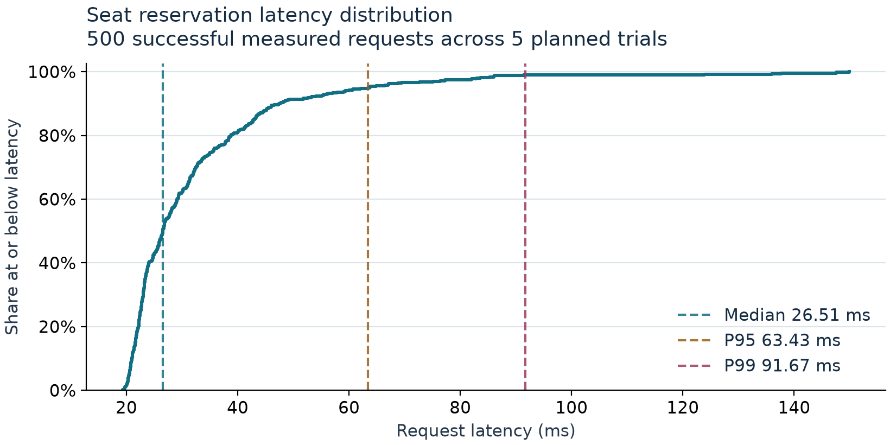
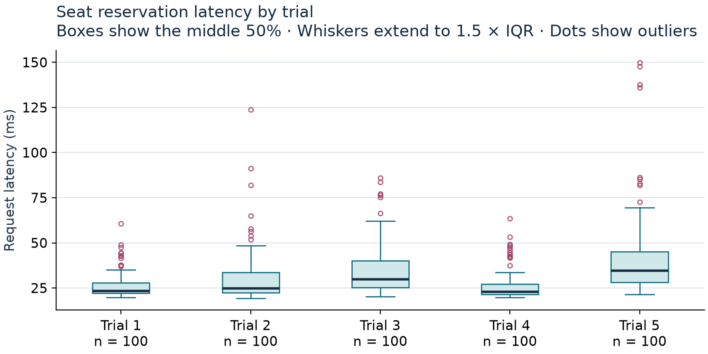

# TC-14 extended seat reservation baseline

19 November 2026 · Kind on Docker Desktop · Run `tc14-extended-20261119`

## Results

All five trials passed in 8 minutes 25 seconds, including setup, checks and cleanup. All 500 measured requests created active holds. There were zero failed or missing requests and zero SQL invariant violations. All 50 warm-up reservations succeeded and stayed out of the latency statistics. Every trial finished with 110 held seats and 90 available seats in Section C. The saved inventory matched each HTTP hold's owner and seat.

| Trial | Successful | Failed | SQL violations | Mean (ms) | Median (ms) | P95 (ms) | P99 (ms) | SD (ms) | Min (ms) | Max (ms) |
| --- | ---: | ---: | ---: | ---: | ---: | ---: | ---: | ---: | ---: | ---: |
| 1 | 100 | 0 | 0 | 26.41 | 23.45 | 43.03 | 49.05 | 7.32 | 19.77 | 60.63 |
| 2 | 100 | 0 | 0 | 30.97 | 24.77 | 56.39 | 91.67 | 15.65 | 19.34 | 123.82 |
| 3 | 100 | 0 | 0 | 34.63 | 29.69 | 66.91 | 83.60 | 14.52 | 20.18 | 86.03 |
| 4 | 100 | 0 | 0 | 26.32 | 22.88 | 46.16 | 53.33 | 8.54 | 19.66 | 63.42 |
| 5 | 100 | 0 | 0 | 42.76 | 34.61 | 85.33 | 147.62 | 25.57 | 21.43 | 149.88 |
| **Pooled** | **500** | **0** | **0** | **32.22** | **26.51** | **63.43** | **91.67** | **16.82** | **19.34** | **149.88** |





The pooled median was **26.51 ms** and the pooled P95 was **63.43 ms**. Trial medians ranged from 22.88 to 34.61 ms. Trial 5 had the widest spread and contained four of the five longest measurements. All observed tail latencies were retained. The timing captures the whole local direct HTTP path, so these measurements alone cannot assign the tail variation to the client, port-forward, seat API, database or shared host. The five fresh trials quantify typical latency and tail variability for this host, fixture and sequential request path. Per-trial P99 is sensitive to individual slow requests with only 100 observations. A production latency target, concurrent capacity or end-to-end booking time requires a different workload.

## Experimental methodology

**Measurement boundary.** A single host Python client sent `POST /seats/hold` through a temporary loopback `kubectl port-forward` to the `seat-api` Service. Each request had a unique ID, `section="C"`, and `party_size=1`. Request ID lengths were fixed across trials within each phase. The timer used `time.perf_counter_ns()` from HTTP connection object creation through reading the complete response body, or until a transport failure. Every attempt opened a fresh TCP connection, with a 15-second socket timeout, one in-flight client request and no retries. The window includes local transport, the Kubernetes port-forward, seat API handling and the PostgreSQL hold transaction. End-to-end booking latency would include browser and frontend traffic, waiting-room admission, batching, allocation, and payment through confirmation.

**Independence and inventory.** Each trial deployed the same standard project manifests in a new disposable namespace with new PostgreSQL and Redis volumes. The production schema and seed job ran normally. A transaction expanded the fixture's Section C from one row to 20 rows of ten, using the existing seat identifiers and constraints. Before issuing holds, the collector verified 200 available C seats, an empty holds table and zero SQL violations. Every run started with the same inventory and used first-fit selection in the same order. This protocol preserves enough same-section inventory for the ten warm-ups and all 100 measured attempts, with 90 seats of headroom. Seat availability descends at the same rate in valid trials. The application queries the available set, so the 200-seat fixture is part of the baseline definition.

**Warm-up and measurement.** Kubernetes rollouts, a seat-store health probe, inventory reads and SQL prechecks finished before reservation sampling. The first ten sequential reservations warmed the HTTP handler and database path. Their observations and allocations were retained. The next 100 attempts formed the measured phase, using the same client settings and request shape, with no intervening reset. Payload encoding, JSON decoding, journal writing, setup and audits were outside the timed window.

**Deployment controls.** The single Kind node ran Kubernetes v1.36.4 on Docker Engine 29.9.3 under WSL2. Docker saw 12 logical CPUs and 7.69 GiB of memory. The Windows host used Python 3.11.0. The standard manifests ran one Ready pod per component with fixed replicas, a 300-second hold TTL and batch size 10. Seat API requests were 50m CPU and 96 MiB, with limits of 500m CPU and 256 MiB. The collector compared actual image IDs, configuration, node placement, resources and replica counts across trials. It also checked pod identities and restart counts before and after each trial. The main and existing lab namespaces continued running on the shared host. No concurrent benchmark was launched as part of this execution.

**Outcome verification.** A success required HTTP 200 and an active hold for the expected request, with one held Section C seat and consistent ownership identifiers. A `success=false` body is counted as `UNAVAILABLE`, even with HTTP 200. Other outcomes are `HTTP_ERROR`, `TRANSPORT_ERROR` or `INVALID_RESPONSE`. Each attempt is retained with its timing, phase, response and outcome. After every trial the collector compared the HTTP holds to stored seat owners and ran the project's six seat and two payment SQL checks. A trial passes this protocol when all 110 attempts reserve successfully, ownership and first-fit order reconcile, checks report zero violations, and deployment controls match. The historical TC-14 acceptance criteria still apply to the original three single-request trials.

**Statistics.** Latencies use successful measured requests only. Warm-up requests are counted separately, and failed attempts retain their raw timings and outcome labels. The median is P50. P95 and P99 use linear interpolation at zero-based rank `(n − 1) × p`, with `p` expressed as a fraction. Standard deviation uses the sample denominator `n − 1`. Aggregate figures pool individual samples across trials. The SQL violation total sums the final audit counts across all five trials. An unavailable final audit leaves the aggregate count unavailable. A run with failed or incomplete trials yields provisional descriptive statistics for its observed successes.

## Reproduce the experiment

Start Docker with Linux containers and use the project Kind deployment with its images loaded. See the [Kind setup](../infra/k8s/README.md) if the cluster has yet to be prepared. From the repository root, with Python 3.10 or later and Matplotlib 3.8 or later for plot generation:

```powershell
python experiments/tc14_extended.py --run tc14-extended-repro01
python experiments/tc14_report.py --run tc14-extended-repro01 --output output/tc14-repro01
```

Run one benchmark at a time. Use a new run ID and export path for each cohort. Allow about 5–10 minutes for the five deployments, checks and cleanup. The collector cleans up each namespace it creates and retains trial journals under `.local/test-results/<run-id>/`. The exporter reads those journals offline and writes the two raw formats, summaries, plots and per-trial evidence. Check the run status and the `missing`, `failed` and `invariant_violations` columns before interpreting latency.

## Evidence

- [Raw CSV](../output/tc14-extended-20261119/raw-observations.csv) and [raw JSON](../output/tc14-extended-20261119/raw-observations.json) retain each warm-up and measured HTTP observation.
- [Summary CSV](../output/tc14-extended-20261119/summary.csv) and [summary JSON](../output/tc14-extended-20261119/summary.json) report per-trial and pooled statistics.
- [Environment and protocol](../output/tc14-extended-20261119/experiment.json) record the host, node, commit and manifest hashes. The [trial directories](../output/tc14-extended-20261119/) contain inventory snapshots, deployment observations and SQL audit results.
- The historical observations are in `.local/test-results/tc-fix-regression-v9-TC14-r1` through `r3`, in `customers.json`. All 72 files from those trial directories matched their archival copies byte for byte. The [original results ledger](../output/pdf/GROUP02_Test_Results_and_Distributed_Concepts_Report.pdf) records their acceptance outcome. The historical client used the frontend proxy and the ten-seat Section C fixture. The extended cohort used direct transport and a larger fixture, so its latency values describe a different request path and inventory.
