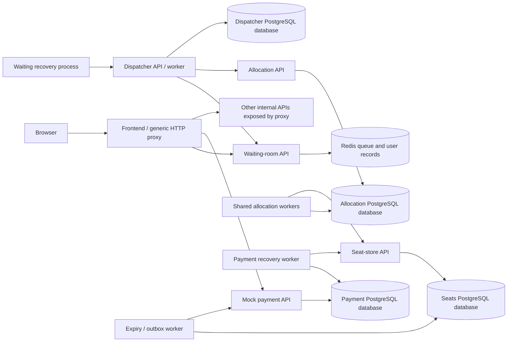

# CSC3104 implementation audit and evidence assessment

Audit date: 8 November 2026 (Singapore). Branch: `twy`. Source revision: `8a777c3f5158de3d7be7c74b2fd000450f177cf2`.

## Assessment conclusion

The source contains a distributed ticket-allocation implementation with meaningful concurrency and recovery mechanisms. It is a credible basis for assessment, but the evidence inspected does **not establish assessment readiness**, improved throughput, improved fairness, or production readiness. A test's existence is evidence of intended coverage, not a passing execution. No performance or fault-injection results were produced in this audit.

The most defensible contribution to investigate is a fixed-snapshot Demand-Cycle policy integrated with transactional adjacent-seat allocation and recoverable distributed handoffs. Its superiority and research originality remain unproven. PostgreSQL provides centralised coordination; this system does not implement consensus or a distributed transaction protocol.

## Sources, scope and limitations

Primary sources read:

- The local checkout: service implementations, schemas/migrations, frontend proxy, Dockerfiles, Compose configuration, Kubernetes local manifests/launcher, test fixtures and relevant tests.
- `C:\SIT UNI\2026-2027 T1\Cloud and Distributed Computing\Project_2026-27.pdf`, all four pages: official assignment and assessment criteria.
- `Lecture_00+01-2026.pdf`: concurrency, no global clock, partial failure, scalability and failure handling; particularly pp. 16-18, 22-25 and 29-33.
- `Lecture_03 - IPC.pdf`: synchronous/asynchronous communication, reliability and ordering. HTTP request/response and durable background processing must be described separately.
- `Distributed_Ticketing_System_Final_Design.pdf`, `Technical_Reference.pdf` and `cloud ideation.pdf`: team design intentions, not implementation evidence. Relevant extracted text was inspected; layout was not used as evidence.
- Existing `TESTING.md`, `CONTAINERS.md`, component READMEs and payment `RELIABILITY.md`: useful plans and explanatory claims, not independently verified runtime results.

`GROUP02.docx` is present but was not examined in this phase. Only two lecture PDFs are present at the course directory's top level; the complete lecture series, LMS changes, hosted CI runs, current cloud deployment and external related-work literature were not verified. The audit uses the local revision and does not establish that GitHub has identical contents. No separate numerical marking sheet was found; rubric alignment below uses the official brief's stated criteria.

Runtime checks observed:

- `docker ps` failed because the Docker Desktop Linux-engine pipe is unavailable. No live container inventory was obtained.
- `.venv\Scripts\python.exe --version` and `-m pytest --version` failed: that environment refers to a missing Python 3.15 executable. The existence of `.venv` therefore does not establish a usable environment.
- The bundled document-processing Python is 3.12 and lacks Flask, Pytest, Psycopg, Redis, Requests and Waitress. It was used for PDF extraction only, not as a substitute project runtime.
- The selected kubectl context is AWS EKS, not the intended local Kind lab. Only the context name was read. No cluster contact, scaling, failure injection, data reset, installation or cloud deployment was performed.

## Actual architecture and state ownership

The four PostgreSQL databases share **one PostgreSQL server instance** in the main deployment. These are ownership boundaries, not independent database fault domains (`infra/docker/init-core-db.sh`). Redis is a separate singleton. Local Kind is one control-plane node.

The customer submits section A-D and party size 1-4. Pre-sale users receive random lottery ordering; latecomers receive server-committed queue numbers. The dispatcher claims the next fixed batch (main default 50, permitted maximum 100), persists its identity, submits it, polls results and synchronises outcomes. A subsequent batch waits for allocation outcomes, not payment completion.

For each section, `src/allocation/algorithm.py:prepare_batch` ranks sizes by descending **number of parties**, breaks demand ties by smaller size, and cycles through each nonempty size group, preserving queue order within a size. This is not strict FCFS allocation and does not process all requests of the highest-demand size before the next size.

General-purpose workers claim jobs from PostgreSQL. Only the earliest unfinished job in each section is eligible. Seat-store selects the first contiguous available block in a row and is the sole inventory writer. Payment is a mock lifecycle orchestrator; it never captures money. Expiry releases seats and inserts a notification in the same database transaction. Delivery/reconciliation happens later.

### Important API surfaces

| Component | Implemented endpoints / communication | State authority |
| --- | --- | --- |
| Waiting room | `POST /submit` and `/waiting-room`, `POST /sale/start`, `GET /queue`, `/status`, `/requests/<id>`, queue claim/outcome operations; request checkout/cancel | Redis in main deployment; MemoryStore only for local tests |
| Dispatcher | `POST /batches/next`, `/allocator/status`; batch current/history/input and status reads | Singleton durable dispatcher state row in its PostgreSQL database |
| Allocation | `POST /batches`, `GET /batches/<id>`, `/health`, `/ready`; worker HTTP calls to seat-store | Durable batches, ordered jobs, lease claims, completion outbox |
| Seat-store | `GET /seats/<section>`, `/holds/<hold_id>?request_id=...`; `POST /seats/hold`, `/confirm`, `/expire`, `/cancel` | Holds, seat ownership, hold history and notification outbox |
| Payment | Internal payment/checkout/cancel/event APIs; optional `/customer/*` scoped APIs; authenticated `/metrics` | Attempts, checkout projection, cancellations, inbox, work queue, audit |
| Frontend | Generic `GET/POST /api/<service>/<path>` | No authenticated customer identity or inventory authority |

Exact routes are in each API module; hold transition routes above share the `/seats` prefix. The request rejoin route explicitly returns HTTP 410. A low-level seat-store reoffer facility does not constitute an end-to-end waitlist.

## Implemented concepts versus claims

Status describes inspected code/configuration, not successful deployment or measured benefit.

| Concept | Status and purpose | Verified implementation / evidence boundary |
| --- | --- | --- |
| Network service decomposition | Implemented: separates admission, policy, inventory and payment ownership | HTTP adapters and separate APIs/workers; distribution adds remote-call overhead and failure windows |
| Atomic whole-party reservations | Implemented: prevents overlapping/partial ownership | `seat-store/store.py:31-39,98-157`; advisory request lock, section row lock, transaction, updated-row-count checks; migration unique/FK/check constraints |
| Mutual exclusion across replicas | Implemented through PostgreSQL | Central database locks, not a custom distributed lock service; ordering is request lock then section lock |
| Idempotent reservation/attempt/event operations | Implemented for specific identities | Hold `(request_id,attempt_key)`, unique live booking; payment attempt keys; canonical batch input and event IDs. Does not imply exactly-once transport |
| Shared atomic admission | Implemented in Redis | `queue_store.py`: Lua registration/opening, hashes/zsets, revision WATCH/MULTI for legacy transitions. MemoryStore is unsuitable across processes |
| Durable asynchronous work | Implemented with database polling | Allocation jobs and payment `wy_work`; no RabbitMQ/Kafka or Redis Streams job broker in main path |
| Leases and stale-worker rejection | Implemented | Allocation token/expiry checks in `job_store.py:111-153`; payment `_claim/_finish`; dispatcher `StateStore`. These fence saved acknowledgements, not arbitrary remote side effects; seat idempotency remains necessary |
| Transactional outbox / durable inbox | Implemented | Seat release + notification commit together; allocation completion + outbox; payment inbox/event deduplication and durable work |
| At-least-once callback delivery | Implemented | `seat-store/workers.py`, allocation `dispatcher_client.py`, payment recovery; lost acknowledgements cause repeats. Prove harmless repeated business effects |
| Cross-service eventual reconciliation | Implemented, conditional on recovery progress | Saved handoff states, same identity on retry, seat-store authoritative reads. No atomic transaction spanning Redis and all databases |
| Concurrent housekeeping | Implemented | Seat expiry and delivery loops, payment recovery, dispatcher and waiting recovery processes |
| Fixed-batch admission bound | Implemented | Default 50, upper limit 100; bounds admitted allocation jobs, not total queued users or frontend requests |
| Adaptive admission | Telemetry only | `admission_control.py` records local rolling load for `/status`; admission is controlled by the external fixed-batch dispatcher. Unused permit enforcement has been removed |
| Demand-Cycle scheduling | Implemented; benefit unmeasured | Pure snapshot validation and ordering. Fairness depends on a stated objective and workload |
| Horizontal worker/API execution | Supported by shared-state design; main configured replicas = 1 | Need concurrent **PostgreSQL** worker and networked API evidence; SQLite multiprocess tests do not establish PostgreSQL behavior |
| Containerisation / orchestration | Configured with real launch paths | Dockerfiles, Compose, Deployments, StatefulSets, Services, init Jobs. Builds and clean deployment not verified here |
| Service discovery / routing | Configured | Internal Kubernetes Service URLs/selectors and Compose names. Multiple backend utilisation is not measured |
| Restart persistence | Configured | PostgreSQL PVC and Redis AOF + PVC; AOF `appendfsync always`. No demonstrated RPO/RTO or backup restore in this audit |
| Health / resource controls | Configured, incomplete worker coverage | API startup/readiness/liveness probes, CPU/memory requests/limits, security contexts; no probes in local worker manifests |
| Autoscaling | Optional configuration only | Payment-specific HPA, 2-4 API replicas at 70% requested CPU; not part of the main local manifest set. Metrics availability and HPA response unverified |
| Security / quotas / metrics | Partially implemented end to end | Payment internal token, optional signed scoped grants, DB-backed quotas, bounded pool, audit and metrics; frontend bypass below limits overall protection |
| Waitlist, rejoin, automatic reoffer workflow | Not implemented in current customer journey | Retired rejoin route; unavailable/expired/cancelled are exits. Earlier project intentions differ |
| HA storage, multi-node failover, backups, consensus, serverless | Not implemented in inspected main local deployment | Do not credit singletons/PVCs with these capabilities; serverless is optional in the brief |

Locking interpretation follows the [PostgreSQL 17 locking documentation](https://www.postgresql.org/docs/17/explicit-locking.html). HPA configuration requires functioning metrics, as described in the [Kubernetes HPA documentation](https://kubernetes.io/docs/concepts/workloads/autoscaling/horizontal-pod-autoscale/); neither reference demonstrates this project's runtime behavior.

## Critical findings, in priority order

### A1. Demo proxy bypasses the customer trust boundary - verified code path

`frontend/server.py:25-41` accepts generic GET/POST paths to internal services and injects the payment service credential. There is no preceding customer authentication or reservation-ownership check. It exposes internal seat mutations, sale start and queue operations as well as privileged payment calls through the same proxy. Moving a secret out of JavaScript protects the token string but does not authorise the caller. Payment-scoped grants do not protect this alternate route.

Impact: the public-facing demo path cannot support claims that users can only pay/cancel their own reservation or that customer outcomes are always server-selected. Main exposure is loopback, so the current intended local demonstration has a narrower trust model; this must be stated. Before public deployment, introduce authenticated ownership checks and an explicit customer route allowlist, remove raw internal routes from the customer gateway, and enforce service access boundaries. Do not add a new platform merely to fix routing.

### A2. One blocked allocation can halt every future batch - verified gate; recovery scenario needs execution

`allocation/job_store.py:98-99,116-117,144` refuses a new batch while ANY previous job is unfinished, including `BLOCKED`. Same-section successors also wait behind that job. The allocation API exposes no operator retry/reconciliation route. Payment has an operator `retry-work` command, but that does not repair allocation jobs.

A particularly valuable reproduction is: commit a hold, lose the response or kill the worker before `finish`, keep recovery unavailable beyond the 300-second deadline, then resume. Seat-store rejects a replay of the expired original attempt (`store.py:118-121`); `seat_client.py` classifies HTTP 409 as nonretryable; the allocator can become BLOCKED. This is a **code-derived failure hypothesis**, not an observed failure. Safely reconcile the authoritative expired hold into an agreed terminal allocation outcome without making a fresh booking or silently treating arbitrary conflicts as unavailable.

### A3. Parallelism is bounded by four sections, and by section skew

`job_store.py:118-133` admits at most one in-flight job per section. Thus active hold calls are bounded by `min(workers, nonempty eligible sections)` and at most four for A-D. Under single-section load, extra workers cannot increase hold-call concurrency. A slow/retrying head prevents its section progressing, and the fixed-batch barrier delays all subsequent batches. This trades deterministic ordering and simple correctness for throughput and availability. It is not automatically a defect; report the trade-off and measure it.

Every PostgreSQL `JobStore.transaction()` takes the common scheduler row lock (`:39`), including batch status reads and completion operations. Queue polling/readiness and claims can therefore compete. Adding workers may increase lock/connection overhead after useful parallelism saturates.

### A4. Storage and the single local node are failure domains

`infra/k8s/local/storage.yaml` configures one PostgreSQL and one Redis instance. `kind.yaml` contains one node. Four SQL databases still share server resources/failure. PVCs support some process/Pod replacement scenarios, not continuing service through server/node/storage loss. Redis and PostgreSQL outage experiments must measure honest unavailability and eventual recovery rather than require uninterrupted successful bookings. Cluster deletion is explicitly outside the local persistence guarantee.

### A5. Environment reproducibility currently fails before tests start

The checked-in environment guide requires Python 3.15; the project venv's base executable is absent. Container Python versions also differ: frontend 3.11, waiting room 3.12 and core services 3.15. Version diversity is not inherently wrong, but contradicts any claim of one uniform runtime and expands the validation matrix. Repair or recreate the project environment while preserving local configuration/data, then validate clean builds and per-component tests. No dependency compatibility failure is inferred solely from version differences.

### A6. Current load tool cannot establish full-system capacity

`waiting-room/tools/load.py` reports aggregate HTTP timings using a closed-loop thread pool. Registration maps section and party size from the same `i % 4`, so A receives size 1, B size 2, C size 3 and D size 4; this is unsuitable for independent section/size fairness comparisons. It generates new UUID users and does not collect booking completion latency, per-request records, identity metadata, resource usage, offered-rate misses, or per-Pod traffic. Its throughput includes unsuccessful requests. Do not call this booking goodput. `/status` reads full queue state and is a different workload from single-request status polling.

### A7. Retained state creates growth and contention risks

`queue_store.py:_read/update` reads complete request/user hashes and queue for legacy transitions, retries a global revision transaction up to 100 times and increments revision even if little changes. Registration traffic can conflict with batch transitions. `batch-dispatcher/state_store.py` retains active/history/events in one growing JSON row and rewrites it. Allocation batches/jobs are retained and the scheduling query considers unfinished predecessors. No retention/archival policy was verified. Measure cost versus accumulated users/batches, separately from instantaneous concurrency.

### A8. A running process is not evidence of progressing work

Local worker manifests contain no startup/readiness/liveness probes; exception loops can keep a stalled process alive indefinitely. Payment's shared heartbeat indicates a pass by any worker, not each worker's health. API readiness is not proof that accepted requests reach terminal outcomes. Capture backlog age, blocked count, completion rate and per-worker activity, and distinguish API availability from recovery progress. The optional metrics endpoint is not a deployed monitoring stack; its HTTP statistics do not supply p95/p99 histograms.

### A9. Several advertised/planned features diverge from implementation

The final-design PDF discusses MySQL, three shared workers, up-to-100 batches and same-section parallel dispatch. Main code uses PostgreSQL, one allocation-worker replica, default batches of 50 and serial section heads. Older references mention waitlists/reoffers; the current journey exits. These changes can be justified, but the report and video must describe the implementation. FCFS admission after sale opening does not imply FCFS seat allocation; lottery order does not prove fairness of success outcomes.

### A10. Local consistency is stronger than cross-service instantaneous consistency

Inventory mutations are transactional; Redis queue, allocation results and payment projections can lag. A successful hold replay preserves identity/deadline, but an unsuccessful no-seat response is not persisted as a durable negative reservation by seat-store. Do not generalise idempotency to a permanently immutable response for every call. Recovery tests must inspect authoritative inventory and eventual projections, not assume that all services instantly agree.

## Official assessment alignment

The brief makes the module project worth 30%. Within this project it lists Proposal 17%, Progress Presentation 15%, Implementation 25%, Presentation 18%, Article/Report 25%. These are not separate weights for individual experiments.

| Official requirement | Current evidence | Needed for a convincing submission |
| --- | --- | --- |
| Container and/or Kubernetes; tested working system (pp. 1,3) | Both configured; launcher/runbooks exist | Clean-checkout build/deploy log, image/runtime identity, successful booking and error workflows |
| Originality, challenge, advertised functionality (pp. 1-4) | Demand-Cycle integrated with safe adjacent-seat ownership and recoverable handoffs | State contribution precisely; compare with correct policy baselines and cited related work; reconcile waitlist scope |
| Concurrency/interference/memory consistency, housekeeping, callbacks (pp. 3-4) | SQL locks/constraints, concurrency tests, background expiry and durable webhook paths | Repeated real-DB concurrent executions, networked integration, crash windows and invariant outputs |
| Quantitative evidence, performance and graphs (pp. 3-4) | Plans, unit/integration source and a queue HTTP load tool | Raw measured trial data, controlled baselines, tail latency/goodput/resources/recovery and failure results |
| IEEE/ACM article around 3,000 words, at most six pages (p. 3) | No final article inspected | Compact evidence-led Evaluation; reserve room for Related Work and design justification |
| Code/image or repository, article PDF, testing-instructions PDF, video (p. 4) | Repository and Markdown test instructions exist | Final deliverables: `GROUP02.pdf`, `GROUP02_INSTRUCTIONS.pdf`, code/image URL and 10-15-minute video; verify accessibility |

The supplied brief states a final deadline of 15 November 2026, 23:59. This is the local brief's date, not an independent check of current LMS announcements. It does not require serverless, a real payment provider, a sophisticated UI, a particular cloud vendor, or storage HA as mandatory features.

## Evidence readiness matrix

Here, Partially Demonstrated means inspected mechanisms/test definitions support part of the dimension, while current passing execution evidence is missing. It does not mean those tests passed.

| Dimension | Classification | Evidence and missing proof |
| --- | --- | --- |
| Normal and concurrent correctness | Partially Demonstrated | Real-DB invariants and adversarial tests exist; no execution obtained here |
| Reliable distributed coordination | Partially Demonstrated | Leases, tokens, same-ID replay and outboxes; long-outage/global-stall case and deployed recovery remain open |
| Meaningful cloud-native benefit | Not Demonstrated | Deployment machinery exists; comparative runtime benefit not measured |
| Scalability under defined workloads | Not Demonstrated | No saved controlled scaling trials; four-section ceiling and shared DB must be tested |
| Fault handling and recovery | Partially Demonstrated | Explicit retry/recovery mechanisms and tests; no independently verified deployment crash timeline/RTO |
| Reproducible deployment/testing | Partially Demonstrated | Manifests/runbooks and isolation guards exist; current local runtime cannot start tests |
| Original technical contribution | Partially Demonstrated | Specific policy is implemented; superiority and relationship to prior art unverified |
| Public production readiness | Not Demonstrated | Customer proxy boundary, singleton dependencies, recovery operations and observability limitations |
| Real payment correctness / provider failover | Not Applicable | Mock payment by design; no money captured |

## Prioritised next actions

1. Restore a working supported test runtime and Docker engine; preserve credentials, volumes and bookings. Use an explicitly selected local kubeconfig/namespace for experiments rather than the active EKS context.
2. Make demo trust assumptions explicit; fix the frontend route/ownership boundary before any public exposure. No public rollout is needed to complete local assessment evidence.
3. Resolve/reproduce allocation recovery beyond hold expiry and define operator handling of BLOCKED jobs. Preserve the original request/hold identity.
4. Execute existing isolated suites and deployed smoke tests with saved logs; do not replace real PostgreSQL/Redis assertions with mocks to obtain passes.
5. Run the five experiments in `EVALUATION_MATRIX.md`; first close correctness and recovery gates, then quantify scaling and policy trade-offs.
6. Freeze the measured revision, update architecture claims and produce the required test-instructions PDF/video/article from actual evidence.

Phases 6-7 (analysis of measured results and final Evaluation prose) remain pending actual measurements. A final readiness judgement must be revisited after those measurements; configuration and this audit cannot substitute for them.
