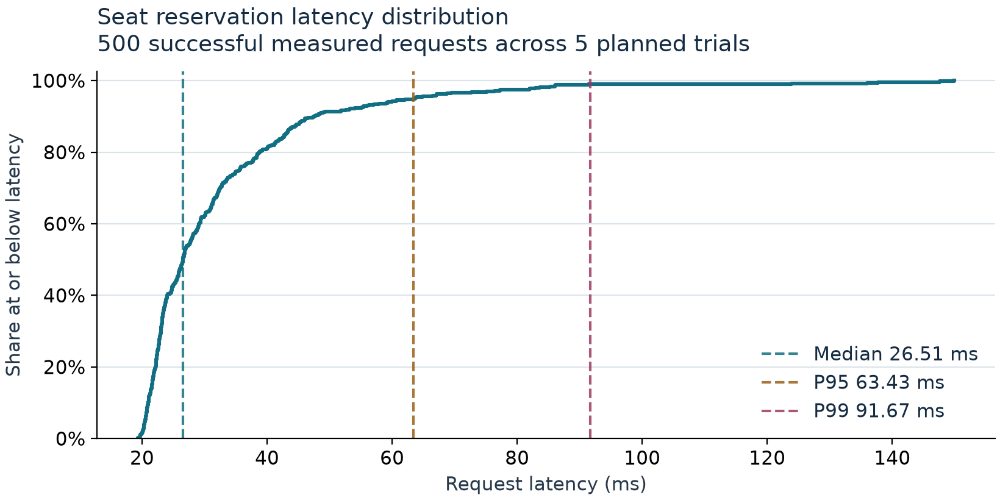
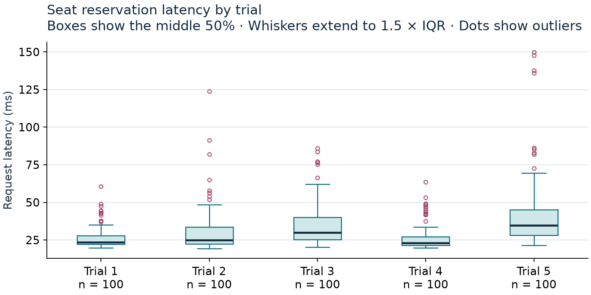

# Fair Seat Allocation

## Verified Test Results and Distributed Systems Concepts

CSC3104 Cloud and Distributed Computing | Group 02

All 25 distinct documented test cases passed their recorded local acceptance conditions. This result combines fifteen newly completed final-version functional/browser/deployment checks with ten full original-scope final v9 studies, whose raw evidence was independently re-audited. It is not a promise that every case will pass on another machine or a production reliability estimate.

The application/configuration source matched 96 files in the final v9 snapshot. No application code was changed for the new functional verification. New harnesses reuse existing lab, workload and invariant tools. Original rates, counts, hold deadlines and safety checks were retained.

The consolidated results below supersede the older coverage/status statements in the two original reports. Earlier source reports remain preserved in the historical evidence archive; their failed/inconclusive attempts are not relabelled. Use PDF bookmarks to navigate the current results.

## Follow-up evaluation scope

All 64 planned evaluation units are complete: four full HPA cycles, 30 matched
scheduler pairs, 21 capacity trials and nine burst trials. Completion includes
inconclusive outcomes; it does not imply every workload or SLO passed. Three
historical interrupted attempts remain retained separately and are not extra
completed samples. No planned reruns remain.

This extends the original 25-case evidence without replacing its results. Only
the existing private `kind-csc3104` cluster and `csc3104-lab` namespace were used,
one deployed experiment at a time. Application/configuration hashes and image
IDs remained unchanged. Existing images and sealed preservation archives were
reused. No commit or branch change was made; the branch remains `twy`.

Verification ledger: output/validation/all25/all25-audit.json. All case IDs, raw folder references, retries and independent checks are retained there.

Independent verification: 77 new evidence/coverage/continuity checks and 244 original-workload raw checks passed, with zero failed checks. These counts are distinct from the 25 case IDs and are not a statistical reliability estimate.

The audit ledger selects the recorded validation cohorts. Observations and exact source/image/configuration details are in each run folder.

Scope: local single-node Kind and isolated Compose; mock payments; browser sessions. No verified accounts, node failover, storage HA, consensus, exactly-once transport or public production security is claimed.


---


## All 25-case result matrix

TC-01 to TC-13, TC-17 and TC-25: new final-version checks. TC-14/15/16/18/19/20/21/22/23/24: full-scope final v9 runs, independently re-audited with unchanged application sources. Each case below links its actual cohort.

| Case / observed result | Scenario |

| TC-01 - PASS | Register, allocate, pay and refresh |

| TC-02 - PASS | Decline and retry the same hold |

| TC-03 - PASS | Cancel the whole unpaid party |

| TC-04 - PASS | Original expiry and actual late-payment rejection |

| TC-05 - PASS | Whole-party capacity and same-user tabs |

| TC-06 - PASS | Invalid input and unknown identifiers |

| TC-07 - PASS | Asynchronous handoffs and late arrivals |

| TC-08 - PASS | Concurrent seat ownership |

| TC-09 - PASS | Compose packaging and internal networking |

| TC-10 - PASS | Kubernetes API replacement and Service routing |

| TC-11 - PASS | Durable payment with no consumer |

| TC-12 - PASS | Queued allocation with no consumer |

| TC-13 - PASS | Payment recovery through seat API outage |

| TC-14 - PASS | Single-request baseline |

| TC-15 - PASS | Scheduled registration |

| TC-16 - PASS | One, two and four allocation workers |

| TC-17 - PASS | Store pod replacement with retained PVCs |

| TC-18 - PASS | Demand-Cycle versus FCFS |

| TC-19 - PASS | Thousands of arrivals and mixed parties |

| TC-20 - PASS | Payment, cancellation and expiry races |

| TC-21 - PASS | Lost committed reply and abrupt worker crash |

| TC-22 - PASS | Sustained Redis/PostgreSQL outages |

| TC-23 - PASS | Waiting-room API replicas and tested capacity |

| TC-24 - PASS | Automatic scale out, in and out again |

| TC-25 - PASS | Browser ownership, disconnection and return |


---


## TC-01 | Register, allocate, pay and refresh | PASS

**Observed result.** Two adjacent A seats (A-1-1, A-1-2) confirmed for the original request/hold and retained after actual browser reload.

**Cloud/distributed systems significance.** Cooperating services retain one business identity; authoritative seat ownership survives browser reload.

**Interpretation and detail.** Request 45cf1b49-ab11-48db-9616-c07387dda76e; hold a8921d9f-93a5-4a2b-a688-f051ec97cb14; original deadline 2026-11-14T09:34:35.497721+00:00.

**Evidence.** .local/test-results/examiner-20261114-final-a/journeys. Case-level raw checks: all25-audit.json; run/cohort: examiner-20261114-final-a.

## TC-02 | Decline and retry the same hold | PASS

**Observed result.** A real decline kept the original active hold; a successful retry confirmed B-1-1, B-1-2 without extending the original deadline.

**Cloud/distributed systems significance.** Payment attempts and reservations have separate state. Retrying a decline does not extend scarce inventory ownership.

**Interpretation and detail.** Request 93111220-dd47-4039-be60-4a103acf191f; hold 087a47e1-2529-4cab-8be8-51ce6f135685; original deadline 2026-11-14T09:34:38.927365+00:00.

**Evidence.** .local/test-results/examiner-20261114-final-a/journeys. Case-level raw checks: all25-audit.json; run/cohort: examiner-20261114-final-a.


---


## TC-03 | Cancel the whole unpaid party | PASS

**Observed result.** The three-seat C party became CANCELLED. All original seats (C-1-1, C-1-2, C-1-3) became AVAILABLE; reload remained terminal and payment unavailable.

**Cloud/distributed systems significance.** Whole-party release and terminal cancellation protect unrelated ownership and prevent abandoned seat fragments.

**Interpretation and detail.** Request 52e8c5e3-f35f-40db-b9f4-b2c0ba7af507; hold f5d5102d-b1fe-46bd-bb1f-844584715bf0; original deadline 2026-11-14T09:34:45.397827+00:00.

**Evidence.** .local/test-results/examiner-20261114-final-a/journeys. Case-level raw checks: all25-audit.json; run/cohort: examiner-20261114-final-a.

## TC-04 | Original expiry and actual late-payment rejection | PASS

**Observed result.** The unchanged five-minute D hold became EXPIRED and its seat (D-1-1) became AVAILABLE. An actual payment POST against that same expired hold returned HTTP 409.

**Cloud/distributed systems significance.** Time-bounded claims are reclaimed asynchronously; the backend rejects late payment independently of a client countdown.

**Interpretation and detail.** Request a32e745f-da44-479a-8878-1dd69468810c; hold ac44c4fe-0d04-4819-849f-4a29f60e77b7; original deadline 2026-11-14T09:34:49.662148+00:00.

**Evidence.** .local/test-results/examiner-20261114-final-a/journeys. Case-level raw checks: all25-audit.json; run/cohort: examiner-20261114-final-a.


---


## TC-05 | Whole-party capacity and same-user tabs | PASS

**Observed result.** Exactly two C/4 parties reserved eight of ten seats; the third was UNAVAILABLE. Both tabs were actually refreshed and retained the same request, hold, seats, queue position and original deadline. SQL invariants passed.

**Cloud/distributed systems significance.** All-or-nothing party allocation and server-authoritative records keep capacity safe across multiple client views.

**Interpretation and detail.** Raw browser states and both after-refresh screenshots are retained.

**Evidence.** .local/test-results/examiner-20261114-final-a/capacity. Case-level raw checks: all25-audit.json; run/cohort: examiner-20261114-final-a.

## TC-06 | Invalid input and unknown identifiers | PASS

**Observed result.** Six invalid registrations returned HTTP 400; nonexistent request and section reads returned HTTP 404. The complete before/after queue was identical.

**Cloud/distributed systems significance.** Stable service contracts reject malformed input before it becomes queue work; HTTP400 and 404 have distinct meanings.

**Interpretation and detail.** Eight real HTTP assertions; no valid booking was created by this case.

**Evidence.** .local/test-results/examiner-20261114-final-a/validation. Case-level raw checks: all25-audit.json; run/cohort: examiner-20261114-final-a.


---


## TC-07 | Asynchronous handoffs and late arrivals | PASS

**Observed result.** The original A/2 customer confirmed. Four B/1 parties added through the real administrator Simulate users form automatically reserved as latecomers. Five distinct requests correlated; dispatcher work completed and allocation completion receipts delivered.

**Cloud/distributed systems significance.** Durable asynchronous stages converge through correlated request, batch and hold IDs and delivered completion receipts.

**Interpretation and detail.** The optional payment callback is outside the delivered allocator-completion claim.

**Evidence.** .local/test-results/examiner-20261114-final-a/flow. Case-level raw checks: all25-audit.json; run/cohort: examiner-20261114-final-a.

## TC-08 | Concurrent seat ownership | PASS

**Observed result.** All 20 original concurrent clients completed: ten RESERVED, ten UNAVAILABLE, no UNKNOWN. Peak overlapping HTTP requests=20; ten unique seats and zero SQL violations.

**Cloud/distributed systems significance.** Concurrent clients contend for one inventory while seat-store transactions and locks preserve unique ownership.

**Interpretation and detail.** Direct seat-store contention bypasses queue scheduling and payment.

**Evidence.** .local/test-results/examiner-20261114-final-a/contention. Case-level raw checks: all25-audit.json; run/cohort: examiner-20261114-final-a.


---


## TC-09 | Compose packaging and internal networking | PASS

**Observed result.** The submitted launcher and Compose file started 13 runtime containers; all three initialization containers exited with code 0. Only frontend loopback was published; proxied PostgreSQL seat-store health succeeded. The isolated test project was then stopped, with volumes retained.

**Cloud/distributed systems significance.** Separate containers communicate through internal service names; API and storage ports need not be public.

**Interpretation and detail.** Project-name/port isolation preserved pre-existing deployments; this is local container evidence.

**Evidence.** .local/test-results/examiner-20261114-compose-b/compose. Case-level raw checks: all25-audit.json; run/cohort: examiner-20261114-compose-b.

## TC-10 | Kubernetes API replacement and Service routing | PASS

**Observed result.** A confirmed booking survived actual allocation API pod deletion. The replacement had a new UID and a Ready Service endpoint; all three API probes were configured, original PVC identities remained, and browser reload retained the same confirmed booking.

**Cloud/distributed systems significance.** A controller replaces application compute and a stable Service routes to the Ready replacement; state lives outside the API pod.

**Interpretation and detail.** This checks pod replacement, not injected probe failure, continuous availability or node failover.

**Evidence.** .local/test-results/examiner-20261114-final-a/replacement. Case-level raw checks: all25-audit.json; run/cohort: examiner-20261114-final-a.


---


## TC-11 | Durable payment with no consumer | PASS

**Observed result.** With zero payment-worker pods, a real browser submitted one payment. It remained pending, API health stayed available and no seat falsely confirmed. Restoration completed that same payment/hold exactly once, with original seats/deadline and passing invariants.

**Cloud/distributed systems significance.** Durable acceptance is separate from execution. A paused consumer does not lose payment intent or falsely confirm seats.

**Interpretation and detail.** A controlled consumer pause is distinct from an abrupt commit-boundary crash (TC-21).

**Evidence.** .local/test-results/examiner-20261114-final-a/payment-pause. Case-level raw checks: all25-audit.json; run/cohort: examiner-20261114-final-a.

## TC-12 | Queued allocation with no consumer | PASS

**Observed result.** With zero allocator pods, the original B/2 request remained as a zero-attempt queued job with no hold. The restored worker reserved the same request; browser payment confirmed it once and SQL invariants passed.

**Cloud/distributed systems significance.** A saved allocation job progresses after its worker returns, without another registration or a replacement business identity.

**Interpretation and detail.** An empty paused inventory is not treated as a booking safety PASS; final nonempty ownership is checked.

**Evidence.** .local/test-results/examiner-20261114-final-a/allocation-pause. Case-level raw checks: all25-audit.json; run/cohort: examiner-20261114-final-a.


---


## TC-13 | Payment recovery through seat API outage | PASS

**Observed result.** Seat API had zero pods while payment-worker was Ready. Real dependency failures retained one pending payment and one unconfirmed hold; checkout returned HTTP 503. After restoration the original payment confirmed the same hold/seats before the unchanged expiry.

**Cloud/distributed systems significance.** Partial dependency failure retains pending work with backoff. Recovery preserves the original hold and deadline.

**Interpretation and detail.** The initial diagnostic-query error is retained separately; the completed corrected rerun supplies this result.

**Evidence.** .local/test-results/examiner-20261114-seat-d/seat-outage. Case-level raw checks: all25-audit.json; run/cohort: examiner-20261114-seat-d.

## TC-14 | Single-request baseline | PASS

**Observed result.** Three fresh trials each made one C/1 direct HTTP request: one reservation each, no unknown outcome and zero invariant violations. Each trial has one timing sample, so mean=P95 within a trial.

**Cloud/distributed systems significance.** A direct one-sample HTTP baseline is useful instrumentation, but is not an end-to-end booking latency distribution.

**Interpretation and detail.** Read actual per-run timings in tc-fix-regression-v9-TC14-r1/r2/r3/metrics.json.

**Evidence.** .local/test-results/tc-fix-regression-v9. Case-level raw checks: all25-audit.json; run/cohort: tc-fix-regression-v9.

**TC-14 extended study.** Five fresh trials at concurrency one produced 500 successful measured seat holds with zero failures or SQL invariant violations. The pooled median was 26.51 ms, P95 was 63.43 ms and P99 was 91.67 ms. Timing runs from the host client through a direct port-forward to seat-store and covers the hold transaction. End-to-end booking includes admission, allocation and payment. The full extended results, charts, methodology and reproduction steps follow in this section. The [supporting evidence report](../../docs/TC14_EXTENDED_RESULTS.md) also links the raw data.

### Extended direct seat-store baseline

Kind on Docker Desktop · Run `tc14-extended-20261119`

#### Results

All five trials passed in 8 minutes 25 seconds, including setup, checks and cleanup. All 500 measured requests created active holds. There were zero failed or missing requests and zero SQL invariant violations. All 50 warm-up reservations succeeded and stayed out of the latency statistics. Every trial finished with 110 held seats and 90 available seats in Section C. The saved inventory matched each HTTP hold's owner and seat.

| Trial | Successful | Failed | SQL violations | Mean (ms) | Median (ms) | P95 (ms) | P99 (ms) | SD (ms) | Min (ms) | Max (ms) |
| --- | ---: | ---: | ---: | ---: | ---: | ---: | ---: | ---: | ---: | ---: |
| 1 | 100 | 0 | 0 | 26.41 | 23.45 | 43.03 | 49.05 | 7.32 | 19.77 | 60.63 |
| 2 | 100 | 0 | 0 | 30.97 | 24.77 | 56.39 | 91.67 | 15.65 | 19.34 | 123.82 |
| 3 | 100 | 0 | 0 | 34.63 | 29.69 | 66.91 | 83.60 | 14.52 | 20.18 | 86.03 |
| 4 | 100 | 0 | 0 | 26.32 | 22.88 | 46.16 | 53.33 | 8.54 | 19.66 | 63.42 |
| 5 | 100 | 0 | 0 | 42.76 | 34.61 | 85.33 | 147.62 | 25.57 | 21.43 | 149.88 |
| **Pooled** | **500** | **0** | **0** | **32.22** | **26.51** | **63.43** | **91.67** | **16.82** | **19.34** | **149.88** |





The pooled median was **26.51 ms** and the pooled P95 was **63.43 ms**. Trial medians ranged from 22.88 to 34.61 ms. Trial 5 had the widest spread and contained four of the five longest measurements. All observed tail latencies were retained. The timing captures the whole local direct HTTP path, so these measurements alone cannot assign the tail variation to the client, port-forward, seat API, database or shared host. The five fresh trials quantify typical latency and tail variability for this host, fixture and sequential request path. Per-trial P99 is sensitive to individual slow requests with only 100 observations. A production latency target, concurrent capacity or end-to-end booking time requires a different workload.

#### Experimental methodology

**Measurement boundary.** A single host Python client sent `POST /seats/hold` through a temporary loopback `kubectl port-forward` to the `seat-api` Service. Each request had a unique ID, `section="C"`, and `party_size=1`. Request ID lengths were fixed across trials within each phase. The timer used `time.perf_counter_ns()` from HTTP connection object creation through reading the complete response body, or until a transport failure. Every attempt opened a fresh TCP connection, with a 15-second socket timeout, one in-flight client request and no retries. The window includes local transport, the Kubernetes port-forward, seat API handling and the PostgreSQL hold transaction. End-to-end booking latency would include browser and frontend traffic, waiting-room admission, batching, allocation, and payment through confirmation.

**Independence and inventory.** Each trial deployed the same standard project manifests in a new disposable namespace with new PostgreSQL and Redis volumes. The production schema and seed job ran normally. A transaction expanded the fixture's Section C from one row to 20 rows of ten, using the existing seat identifiers and constraints. Before issuing holds, the collector verified 200 available C seats, an empty holds table and zero SQL violations. Every run started with the same inventory and used first-fit selection in the same order. This protocol preserves enough same-section inventory for the ten warm-ups and all 100 measured attempts, with 90 seats of headroom. Seat availability descends at the same rate in valid trials. The application queries the available set, so the 200-seat fixture is part of the baseline definition.

**Warm-up and measurement.** Kubernetes rollouts, a seat-store health probe, inventory reads and SQL prechecks finished before reservation sampling. The first ten sequential reservations warmed the HTTP handler and database path. Their observations and allocations were retained. The next 100 attempts formed the measured phase, using the same client settings and request shape, with no intervening reset. Payload encoding, JSON decoding, journal writing, setup and audits were outside the timed window.

**Deployment controls.** The single Kind node ran Kubernetes v1.36.4 on Docker Engine 29.9.3 under WSL2. Docker saw 12 logical CPUs and 7.69 GiB of memory. The Windows host used Python 3.11.0. The standard manifests ran one Ready pod per component with fixed replicas, a 300-second hold TTL and batch size 10. Seat API requests were 50m CPU and 96 MiB, with limits of 500m CPU and 256 MiB. The collector compared actual image IDs, configuration, node placement, resources and replica counts across trials. It also checked pod identities and restart counts before and after each trial. The main and existing lab namespaces continued running on the shared host. No concurrent benchmark was launched as part of this execution.

**Outcome verification.** A success required HTTP 200 and an active hold for the expected request, with one held Section C seat and consistent ownership identifiers. A `success=false` body is counted as `UNAVAILABLE`, even with HTTP 200. Other outcomes are `HTTP_ERROR`, `TRANSPORT_ERROR` or `INVALID_RESPONSE`. Each attempt is retained with its timing, phase, response and outcome. After every trial the collector compared the HTTP holds to stored seat owners and ran the project's six seat and two payment SQL checks. A trial passes this protocol when all 110 attempts reserve successfully, ownership and first-fit order reconcile, checks report zero violations, and deployment controls match. The historical TC-14 acceptance criteria still apply to the original three single-request trials.

**Statistics.** Latencies use successful measured requests only. Warm-up requests are counted separately, and failed attempts retain their raw timings and outcome labels. The median is P50. P95 and P99 use linear interpolation at zero-based rank `(n − 1) × p`, with `p` expressed as a fraction. Standard deviation uses the sample denominator `n − 1`. Aggregate figures pool individual samples across trials. The SQL violation total sums the final audit counts across all five trials. An unavailable final audit leaves the aggregate count unavailable. A run with failed or incomplete trials yields provisional descriptive statistics for its observed successes.

#### Reproduce the experiment

Start Docker with Linux containers and use the project Kind deployment with its images loaded. See the [Kind setup](../../infra/k8s/README.md) if the cluster has yet to be prepared. From the repository root, with Python 3.10 or later and Matplotlib 3.8 or later for plot generation:

```powershell
python experiments/tc14_extended.py --run tc14-extended-repro01
python experiments/tc14_report.py --run tc14-extended-repro01 --output output/tc14-repro01
```

Run one benchmark at a time. Use a new run ID and export path for each cohort. Allow about 5–10 minutes for the five deployments, checks and cleanup. The collector cleans up each namespace it creates and retains trial journals under `.local/test-results/<run-id>/`. The exporter reads those journals offline and writes the two raw formats, summaries, plots and per-trial evidence. Check the run status and the `missing`, `failed` and `invariant_violations` columns before interpreting latency.

#### Evidence

- [Raw CSV](../tc14-extended-20261119/raw-observations.csv) and [raw JSON](../tc14-extended-20261119/raw-observations.json) retain each warm-up and measured HTTP observation.
- [Summary CSV](../tc14-extended-20261119/summary.csv) and [summary JSON](../tc14-extended-20261119/summary.json) report per-trial and pooled statistics.
- [Environment and protocol](../tc14-extended-20261119/experiment.json) record the host, node, commit and manifest hashes. The [trial directories](../tc14-extended-20261119/) contain inventory snapshots, deployment observations and SQL audit results.
- The historical observations are in `.local/test-results/tc-fix-regression-v9-TC14-r1` through `r3`, in `customers.json`. All 72 files from those trial directories matched their archival copies byte for byte. The [original results ledger](GROUP02_Test_Results_and_Distributed_Concepts_Report.pdf) records their acceptance outcome. The historical client used the frontend proxy and the ten-seat Section C fixture. The extended cohort used direct transport and a larger fixture, so its latency values describe a different request path and inventory.

## TC-15 | Scheduled registration | PASS

**Observed result.** Three fresh pre-sale trials each delivered 50/50 offers at 5/s for 10 seconds, with the original one-second maximum launch lag, no rejected/unknown/dropped offers and no missing acknowledgements.

**Cloud/distributed systems significance.** An open-loop arrival schedule separates admission service time, generator launch lag and acknowledged identity retention.

**Interpretation and detail.** This measures admission and response drain, not paid bookings/s.

**Evidence.** .local/test-results/tc-fix-regression-v9. Case-level raw checks: all25-audit.json; run/cohort: tc-fix-regression-v9.

## TC-16 | One, two and four allocation workers | PASS

**Observed result.** The F1 trace (40 parties, seed 42, batch 10, TTL 120 seconds) ran with 1/2/4 workers, three repeats each, both policies and matching fresh inventory. All 18 policy replays passed their terminal-outcome and safety criteria.

**Cloud/distributed systems significance.** Horizontal worker scaling is tested against equivalent physical inventory, workload and policies. Four sections bound useful parallelism.

**Interpretation and detail.** Compare the same policy across worker counts; more replicas do not guarantee improvement.

**Evidence.** .local/test-results/tc-fix-regression-v9. Case-level raw checks: all25-audit.json; run/cohort: tc-fix-regression-v9.


---


## TC-17 | Store pod replacement with retained PVCs | PASS

**Observed result.** Both PostgreSQL/Redis pod UIDs changed while PVC UIDs and volume identities stayed the same. Complete captured holds, seats, payments, allocation jobs and queue matched strictly before/after; the original browser booking survived and a new booking confirmed.

**Cloud/distributed systems significance.** StatefulSets reuse persistent volumes across pod replacement. A fresh booking after recovery proves forward progress beyond old-data reads.

**Interpretation and detail.** The comparison does not silently remove metadata fields. Retained local storage is not storage HA or a backup.

**Evidence.** .local/test-results/examiner-20261114-final-a/storage. Case-level raw checks: all25-audit.json; run/cohort: examiner-20261114-final-a.

## TC-18 | Demand-Cycle versus FCFS | PASS

**Observed result.** Ten independent F1 seeds 42-51 ran with both policies at one worker, producing 20 passing policy replays and 40 interpretable paired section observations. Identical input fingerprints and fresh physical inventory were checked.

**Cloud/distributed systems significance.** Controlled paired policies expose reservation, wait, utilization and fairness trade-offs rather than assuming one policy is superior.

**Interpretation and detail.** These original F1 results do not certify the separate F2-F7 explorations, statistical significance or fairness superiority.

**Evidence.** .local/test-results/tc-fix-regression-v9. Case-level raw checks: all25-audit.json; run/cohort: tc-fix-regression-v9.

### Follow-up scheduler comparisons

Each scenario has ten matched seeds (42–51), 40 parties, batch size 10, one worker
and 120-second holds. Policy order alternates; both policies use matching traces,
inventory and actual batch boundaries. Values below are Demand-Cycle minus FCFS.

| Scenario | Mean Δ confirmed parties | Mean Δ confirmed seats | Mean Δ Jain | Mean Δ rate gap | Interpretable Jain seed / section pairs |
|---|---:|---:|---:|---:|---:|
| F2 | -0.1 | +0.4 | +0.009405 | 0 | 10 / 11 |
| F3 | +0.5 | 0 | +0.028361 | +0.0375 | 8 / 13 |
| F6 | 0 | 0 | 0 | 0 | 10 / 40 |

The original F1 trade-off (more confirmed parties but lower Jain) did not recur
on these mean paired effects. F3 nevertheless has a worse rate gap despite
higher Jain, so these results do not establish general fairness superiority.
Unrepresented sizes remain missing. Jain requires sizes 1–4, known outcomes and
positive service. F6's 35 fixture-occupied seats are excluded from customer
bookings and incremental utilization. Section/size denominators, reservation
rates, decision waits and metric-specific pair counts are retained in the CSVs.


---

## TC-19 | Thousands of arrivals and mixed parties | PASS

**Observed result.** Three complete original 2,100-offer surges passed. Admission completed in 172.24/168.76/158.32 seconds (all below 600 seconds), with maximum launch lag below 0.029 seconds. The mixed test used 40 parties, sizes 1-4 and 32 clients, safely allocating ten C seats.

**Cloud/distributed systems significance.** Burst admission needs both a valid load generator and efficient bounded state access; seat safety remains independently authoritative.

**Interpretation and detail.** All final offers delivered; no HTTP failure, generator drop, missing/duplicate ID, upstream retry or SQL violation.

**Evidence.** .local/test-results/tc-fix-19-v9. Case-level raw checks: all25-audit.json; run/cohort: tc-fix-19-v9.


### Follow-up burst admission

Every trial used 10s at 5/s, 20s at peak, and 10s at 5/s, followed by the original
600s admission deadline. All nine completed trials passed delivery, unique IDs,
stable contiguous queue positions, terminal outcomes and SQL checks. All 27,900
offers were accepted. Admission includes terminal unavailable/expired outcomes,
not thousands of successful seat bookings.

| Peak | Offers / trial | Passing / complete trials | Mean admission (s) | Maximum admission (s) |
|---:|---:|---:|---:|---:|
| 100/s | 2,100 | 3 / 3 | 172.8 | 178.1 |
| 150/s | 3,100 | 3 / 3 | 263.9 | 269.7 |
| 200/s | 4,100 | 3 / 3 | 351.4 | 352.0 |

---

## TC-20 | Payment, cancellation and expiry races | PASS

**Observed result.** Three active and three near-expiry payment/cancellation races passed. The original 20-second near-expiry holds and simultaneous release barrier were retained; each run ended with a consistent confirmed/cancelled/expired winner and zero SQL violations.

**Cloud/distributed systems significance.** Concurrent lifecycle operations must converge to one consistent terminal winner without duplicate payment or conflicting seat ownership.

**Interpretation and detail.** A particular winner is not required; asynchronous execution order may differ.

**Evidence.** .local/test-results/tc-fix-regression-v9. Case-level raw checks: all25-audit.json; run/cohort: tc-fix-regression-v9.


---


## TC-21 | Lost committed reply and abrupt worker crash | PASS

**Observed result.** The proxy committed a real seat hold before dropping its reply; the crash variant additionally SIGKILLed the worker at that checkpoint and observed restart. Both recovered the same request, original hold and deadline, with one hold history and zero SQL violations.

**Cloud/distributed systems significance.** At-least-once transport can lose replies after commit. Stable request identities, leases and fencing support one business effect.

**Interpretation and detail.** Specific idempotent effects do not imply exactly-once network transport.

**Evidence.** .local/test-results/tc-fix-regression-v9. Case-level raw checks: all25-audit.json; run/cohort: tc-fix-regression-v9.

## TC-22 | Sustained Redis/PostgreSQL outages | PASS

**Observed result.** Separate 60-second Redis, PostgreSQL and combined outages preserved a confirmed booking and acknowledged queued work. Restored dependencies allowed the original queued request to allocate safely; all three variants passed.

**Cloud/distributed systems significance.** Durable queue and booking records survive temporary storage unavailability; service availability during the outage is a separate property.

**Interpretation and detail.** No claim of uninterrupted availability while stores were down.

**Evidence.** .local/test-results/tc-fix-regression-v9. Case-level raw checks: all25-audit.json; run/cohort: tc-fix-regression-v9.


---


## TC-23 | Waiting-room API replicas and tested capacity | PASS

**Observed result.** Nine fixed trials each accepted 1,500/1,500 offers at 50/s for 30 seconds. All requested 1/2/4 replicas actually served. Mean trial P95 by replicas was 19.871/16.488/22.142 ms. All 18 capacity points through 200/s passed declared thresholds.

**Cloud/distributed systems significance.** A valid replica comparison needs complete equal offered traffic and proof each requested pod actually served requests.

**Interpretation and detail.** Approximately 50 accepted/s at a fixed offered 50/s is not a speedup. 200/s is the highest passing tested rate, not the true maximum.

**Evidence.** .local/test-results/tc-fix-23-v9. Case-level raw checks: all25-audit.json; run/cohort: tc-fix-23-v9.


### Follow-up API capacity

The unchanged composite SLO requires P95 ≤1,000ms, achieved rate ≥95% of offered,
zero HTTP failures, complete delivery within 1s launch lag, correct IDs/SQL and
all requested API replicas serving. HPA was off; each trial offered a constant
rate for 30s and began from fresh equivalent lab state.

| API replicas | Highest observed passing rate | Passing / valid trials at that rate | First observed valid-delivery miss | Misses / valid trials at that rate |
|---:|---:|---:|---:|---:|
| 1 | 200/s | 3 / 3 | 250/s | 2 / 2 |
| 2 | 250/s | 1 / 3 | 200/s | 1 / 3 |
| 4 | 250/s | 1 / 3 | 250/s | 2 / 3 |

These are observed passing rates, not stable capacity estimates. Repeated
outcomes are mixed and non-monotonic. Three independent attempts were collected
at each selected boundary; the 250/s one-replica point has only two valid-delivery
results because one attempt exceeded the launch-lag limit.

Two complete attempts have invalid delivery: 300/s with one replica saturated
the unchanged 4,096-task pool and dropped 374 offers; an extra 250/s one-replica
trial launched all 7,500 requests but reached 4.08s launch lag. Its maximum task
dispatch lag was 4.07s, with no pool drops and peak occupancy 3,117/4,096. The
evidence identifies a dispatch delay but does not isolate its underlying cause.
Both attempts are retained and excluded from capacity-boundary inference.

All five complete 300/s attempts remain INCONCLUSIVE, with HTTP timeouts and
incomplete accepted-ID reconciliation. Acknowledgements are lower bounds, not
final backend acceptance counts. Reconciled timeouts in other trials also remain
HTTP failures: one 250/s four-replica trial had P95 536ms but failed the SLO because
158 requests timed out. P95 alone is insufficient. SQL observed zero violations;
capacity tests were pre-sale registration tests, not seat-booking throughput tests.


---

## TC-24 | Automatic scale out, in and out again | PASS

**Observed result.** Separate API (19,140 offers) and worker (19,020) cycles both showed actual Ready 1 -> 4 -> 1 -> 4. CPU exceeded the 50% target under load and fell below it during recovery. Worker backlog drained; the first one-worker witness was 589.66 seconds after actual spike offer-end, within 600 seconds.

**Cloud/distributed systems significance.** Elasticity is observed behavior under real demand: CPU signals and actual Ready counts must demonstrate the complete automatic cycle.

**Interpretation and detail.** No manual target scaling after HPA attachment; cleanup deletion is not scale-in. Both original 9,450-offer spikes were retained.

**Evidence.** .local/test-results/tc-fix-24-worker-v9. Case-level raw checks: all25-audit.json; run/cohort: tc-fix-24-worker-v9.

### Follow-up CPU-based HPA

All four retained fresh cycles passed the original 120s baseline, 180s/9,450-offer
spike, 600s zero-arrival recovery, identical repeat spike and 30s observation.
Each observed actual Ready sequence 1,2,3,4,3,2,1,2,3,4. Worker tests held the API
at four Ready replicas throughout; no manual target scaling followed HPA attachment.

| Target / cycle | First scale-out after spike start (s) | One Ready after first spike offer-end (s) | Worker backlog drain after offer-end (s) |
|---|---:|---:|---:|
| API 1 | 67.7 | 150.4 | — |
| API 2 | 79.4 | 153.6 | — |
| Worker 1 | 49.7 | 574.6 | 370.3 |
| Worker 2 | 49.5 | 561.0 | 362.6 |

All original 600s recovery windows were met; no later diagnostic window replaced
an original outcome. These are observed CPU-based HPA results in local Kind.


---

## TC-25 | Browser ownership, disconnection and return | PASS

**Observed result.** Offline refresh, complete browser-process close/reopen and saved-customer selection recovered the same original booking. All 8 copied-identity/mutation attempts in a second profile returned HTTP 403. Admin sign-in/out toggled privilege; denials left the booking unchanged. A second cold return after real expiry showed EXPIRED.

**Cloud/distributed systems significance.** Signed browser ownership and privileged administrator sessions separate customer recovery from cross-user access; these are not verified accounts.

**Interpretation and detail.** No second registration occurred. Browser cookies last seven days, but real elapsed seven-day survival was not tested; cookie deletion and verified-account recovery are not promised.

**Evidence.** .local/test-results/examiner-20261114-final-a/browser. Case-level raw checks: all25-audit.json; run/cohort: examiner-20261114-final-a.


---


## Measured scaling results and interpretation

TC-23 fixed offer=50/s x30s. Each1/2/4 setting repeats three times with fresh equivalent storage and actual serving-pod identities. Rates include response drain. The following values are actual saved v9 measurements.

| Repeat / replicas | Accepted | P95ms | Max lag s |

| 1 / 1 | 1500/1500 | 12.185 | 0.0267 |

| 1 / 2 | 1500/1500 | 13.951 | 0.0299 |

| 1 / 4 | 1500/1500 | 32.233 | 0.0299 |

| 2 / 4 | 1500/1500 | 20.764 | 0.0289 |

| 2 / 2 | 1500/1500 | 17.901 | 0.0295 |

| 2 / 1 | 1500/1500 | 33.553 | 0.0295 |

| 3 / 1 | 1500/1500 | 13.875 | 0.0289 |

| 3 / 2 | 1500/1500 | 17.611 | 0.0297 |

| 3 / 4 | 1500/1500 | 13.429 | 0.0286 |

All original final v9 performance cohorts had zero client HTTP failures, generator drops, missing/duplicate IDs, upstream retries or SQL violations. More replicas did not monotonically improve latency. The capacity grid used 20/40/60/80/100/s x30s, plus separate200/s points at each replica count; single capacity points do not establish confidence intervals or a true maximum.

TC-24 phases per target:120s low baseline,180s original 9,450-offer spike,600s zero arrivals, identical9,450-offer repeat,30s observation. Actual Ready sequence1->4->1->4 was required. API CPU peaked 374% of its50m request and recovered to7%; worker peaked 86% of its200m request and recovered to9.1%. Worker limit remained500m. Waiting-room dependency was fixed at four replicas before worker-only measurement.

Final host/Docker budget:12 logical CPUs, approximately 7.69GiB Docker RAM; gateway CPU limit1core, PostgreSQL2cores. The historical TWY report used 8CPUs/15.5GiB; timing differences are not a controlled before/after performance comparison.


---


## Corrections and measurement validity

The original TWY surge, API-replica and HPA attempts were inconclusive because the offered workload was not fully delivered on schedule and the automatic recovery cycle was not established. Missing offers cannot be counted as successful load. Those original outcomes remain visible in the archived historical reports.

Diagnostics identified client-thread/submission saturation, gateway thread/channel limits and Linux select descriptor limits, Redis global-revision conflicts during simultaneous registration/dispatch, repeated whole-history queue/dispatcher work, polling delays and observed CPU throttling. The fixes reuse the framework: pooled asynchronous arrivals, isolated pooled gateway connections with poll, bounded Redis indexes and fenced scoped updates, append-only transactional dispatcher history, and committed SQL notification hints with durable polling fallback.

Original arrival rates, counts, identities, inventory, deadlines and SQL assertions were retained. Allocation ranking, global ordering, durable claims, leases and authoritative seat-store transactions remain enforced. The calibrated worker HPA request accounts for its measured idle CPU floor; real sale-open allocation jobs supply load, not synthetic CPU activity. API and worker targets are measured separately.

Scheduled launch is the headers-send callback after connection acquisition. Client/session preparation is recorded before the offered-arrival epoch; no HTTP connection or registration is warmed up. Connection delay and runtime stalls after the epoch remain subject to the original one-second launch-lag limit. No client submission retries conceal failures; bounded gateway registration recovery is separately counted.

One intermediate cohort had a genuine upstream 502 whose precise original socket cause was not captured by the old handler. It stays inconclusive. Sanitized exception logging and a narrowly idempotent identical-body registration replay were added; a real lost-reply test checks one ID/party/position. Final performance runs used zero upstream retries. No exact cause is invented for that earlier socket event.

An independent raw-evidence audit rechecks full schedules, HTTP responses, unique acknowledged IDs, stable positions, terminal outcomes, resource/replica evidence, original 600-second HPA recovery and SQL invariants. Full diagnostic chronology and source rationale are in output/validation/tc-fixes/ROOT_CAUSES.md and CHANGES.md. Hardware/resource differences prevent a controlled historical latency-speedup claim.


---


## TC-19 original surge delivery and latency


Graphs are generated from saved measured data, not estimated curves. Cached CPU sampling windows differ from client timing. Complete CSV and SVG counterparts are in output/validation/tc-fixes/report-v9/.


---


## TC-23 fixed load and sampled resources


Graphs are generated from saved measured data, not estimated curves. Cached CPU sampling windows differ from client timing. Complete CSV and SVG counterparts are in output/validation/tc-fixes/report-v9/.


---


## TC-23 tested capacity and shared resources


Graphs are generated from saved measured data, not estimated curves. Cached CPU sampling windows differ from client timing. Complete CSV and SVG counterparts are in output/validation/tc-fixes/report-v9/.


---


## TC-24 automatic cycles and worker backlog


Graphs are generated from saved measured data, not estimated curves. Cached CPU sampling windows differ from client timing. Complete CSV and SVG counterparts are in output/validation/tc-fixes/report-v9/.


---


## Evidence, earlier attempts and submission limits

The original missing GROUP02_TWY_Test_Evidence.zip was not recovered. The original TWY PDF was a diagnostic reference. New raw measurements and failures were generated from the repository and retained; the previously sealed replacement TC19/23/24 evidence ZIP remains unchanged.

New preliminary attempts below did not establish acceptance. Their error files remain alongside the completed reruns; only the independently audited complete attempts support the current PASS matrix.

| Case | Preliminary status | Retained run |

| TC-09 | FAIL | examiner-20261114-final-a |

| TC-13 | FAIL | examiner-20261114-final-a |

| TC-13 | FAIL | examiner-20261114-seat-c |

Evidence trace: all25-audit.json records chosen runs and every preliminary attempt; final-acceptance-audit.json in the same evidence folder rechecks the full v9 workloads. The archived earlier source reports retain their own scope limits, manual observations and inconclusive scaling runs.

A Ready pod alone does not prove useful work. A successful HTTP response does not mean a paid booking. UNAVAILABLE can be a valid capacity outcome. Safety, eventual recovery and continuous availability are different properties; these results do not establish uninterrupted availability during faults.

Retained-state dispatcher upgrades must quiesce both old API and worker before either new process starts. Mixed-version rolling upgrades are unsupported. Fresh isolated lab resets were used for these studies; main storage was not migrated or reset.

Submit the fixed working source and current image build instructions with raw evidence. Exclude .env.core, kubeconfig, generated Secrets and private browser profiles/cookies. Exported evidence logs must be checked for credentials. Do not infer statistical fairness superiority, arbitrary internet scale or a guarantee of an examiner-machine PASS from this local25/25 result.


## Supporting follow-up evidence

- [Compact article table](../validation/followup-20261119/report/ARTICLE_TABLE.md)
- [Short Evaluation paragraph](../validation/followup-20261119/report/ARTICLE_EVALUATION.md)
- [Full results and denominators](../validation/followup-20261119/report/RESULTS.md)
- [Paired scheduler figure](../validation/followup-20261119/report/scheduler-paired-comparison.png)
- [Fresh HPA overview](../validation/followup-20261119/report/hpa-fresh-overview.png)
- [Offered/achieved, latency, HTTP failures and delivery figure](../validation/followup-20261119/report/traffic-offered-achieved.png)
- [Final reviewed evidence bundle](../validation/followup-20261119/GROUP02_Followup_Final_20261119.zip)

The figures also have editable SVG companions. Detailed per-cycle HPA timelines,
timestamped traffic, traces, logs, SQL checks, commands, source hashes, image IDs
and resource settings are retained. Every reported trial has a raw path in
`traffic-trials.csv`, `scheduler-policies.csv`, `hpa-summary.csv` or
`lab-provenance.csv`. The master continuation ledger maps all 64 units and the
historical interruptions. Per-run ledgers distinguish COMPLETE from outcome and
verify evidence hashes; interrupted attempts remain in separate directories.

The saved-data audit passed 1,046 checks with zero failures. Its remaining
interrupted cohort is the superseded, unmatched original F2 attempt; it is not
an unrun planned study. All 30 controlled unit evidence records and all 64 master
unit references were independently hash-verified. Measurement-harness versions are retained with the source hashes;
all workload schedules and acceptance thresholds were preserved;
legacy identity-read availability is inferred from saved queue snapshots when
the older summary predates that explicit flag. Raw files were not rewritten.
